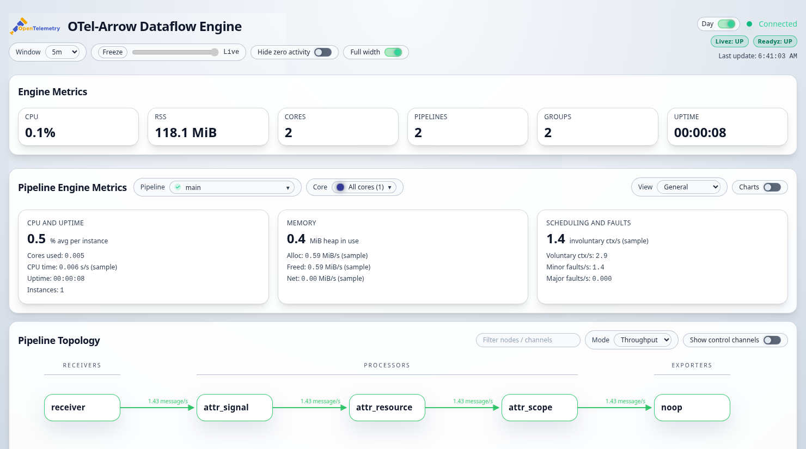
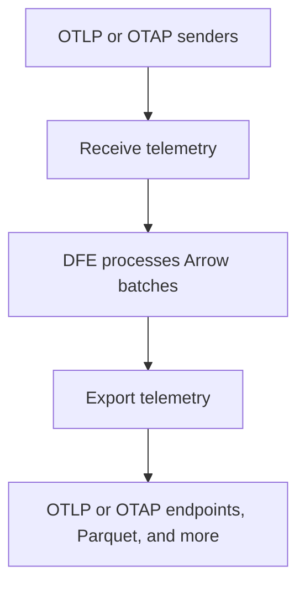

# OpenTelemetry Arrow

The **OpenTelemetry Arrow Dataflow Engine (DFE)** is an embeddable Rust
engine for collecting, processing, and exporting telemetry. It uses the
**OpenTelemetry Arrow Protocol (OTAP)** to keep logs, metrics, and traces in
Apache Arrow columns during transport and processing. It also speaks OTLP, so
you can try it with existing OpenTelemetry senders and backends.

**Status: incubating.** DFE is ready for experimentation. Configuration,
components, and APIs are still evolving. The team is working with the
[OpenTelemetry Governance Committee][governance] to define the engine's
longer-term role and next steps in OpenTelemetry.

[Try the engine](#quick-start) &middot; [Check capabilities][capabilities] &middot;
[Explore benchmarks](#benchmarks-and-talks) &middot; [Contribute](#contributing)

## Quick start

With [Rust and Cargo][rust] installed, build the engine from source and run the
[synthetic telemetry demo][demo]. It generates logs locally and runs them through
three attribute processors.

```sh
git clone https://github.com/open-telemetry/otel-arrow.git
cd otel-arrow/rust/otap-dataflow
cargo build --locked --bin df_engine
./target/debug/df_engine --config configs/trafficgen-attributes-metrics-demo.yaml \
  --num-cores 1 --http-admin-bind 127.0.0.1:8080
```

Open <http://127.0.0.1:8080/> to see pipeline topology and live metrics. Stop
the engine with Ctrl+C.



To run your own pipeline, start with the [configuration guide][config],
[example pipelines][examples], and [admin documentation][admin].
For Rust integration, see the [engine crate][engine-crate] and
[admin SDK][admin-crate] on crates.io and the full list of crates in
the [release notes][releases].

## How it works

OTAP represents telemetry as related Arrow record batches and streams them via
Arrow IPC over gRPC. An OTAP path can preserve the columnar representation
across hops, reducing serialization and allocation. When an OTLP pipeline can
forward its encoded payload as-is, DFE can also avoid decoding it. See the
[OTAP specification][otap-spec], [telemetry data model][data-model], and
[codec guide][codecs].



The diagram shows a path that processes telemetry as Arrow batches.
The engine builds on lessons from existing telemetry pipelines and explores
how much work a pipeline can avoid when transport and processing share a data
representation. Its [architecture][architecture] and
[design principles][principles] prioritize:

- **Performance.** Thread-per-core execution keeps data and work local.
  Columnar batches can share work across records.
- **Reliability.** Bounded queues and backpressure limit work in flight.
  Acknowledgements, retry, and durable buffering support delivery.
- **Security and privacy.** Rust provides memory safety, and supported
  transports offer TLS and authentication options.
- **Serviceability.** [Self-observability][self-observability] exposes
  pipeline behavior. [Live reconfiguration][reconfiguration] can roll out
  changes core by core.

## What works today

| Capability | Status | Scope |
| --- | --- | --- |
| [OTLP][otlp] | Available | Logs, metrics, and traces over gRPC and HTTP. Profiles and entities are outside current coverage. |
| [OTAP][otap-spec] | Available | Logs, metrics, and traces over Arrow IPC/gRPC, with lossless OTLP round-trips for those signals. |
| [Delivery and resource control][resources] | Available; evolving | Bounded queues, backpressure, acknowledgements, retry, and process memory protection. Durable buffering is experimental. |
| [Pipeline operations][admin] | Available; evolving | Health, metrics, the embedded UI, and live reconfiguration. In-process topics and the [OpAMP agent][opamp] are early capabilities. |
| [Programmability][languages] | Experimental | The Transform processor accepts OPL, OTTL, and KQL with different coverage. WASM processor plugins are opt-in. |
| [OpenTelemetry Telemetry Policies][policies] | Early exploration | The OpenTelemetry proposal describes portable, intent-based policies. DFE's scoped runtime policies are documented in the [configuration model][config-model]. |

The [component matrix][capabilities] lists receivers, processors, exporters,
and extensions, including build requirements and work in progress. It also
compares OPL, OTTL, and KQL.

## How it fits with the OpenTelemetry Collector

The Go-based [OpenTelemetry Collector][collector] is the general-purpose
reference implementation with a broad component ecosystem. Its Contrib
distribution includes the [OTel Arrow receiver][go-receiver] and
[exporter][go-exporter]. Those components let Collector deployments use OTAP
between hops and interoperate with DFE. The [Go libraries][go] provide
OTLP/OTAP conversion for Go applications.

DFE explores a columnar data path and ways to embed it in Rust applications.
Interoperability lets users evaluate that design within existing
OpenTelemetry deployments.

## Roadmap

The team is targeting **April&ndash;May 2027** for stabilization of the
**configuration model and main components**. API stability is outside that
milestone. Near-term work emphasizes delivery and recovery, resource controls,
and live and fleet operations. The [DFE roadmap][roadmap] also tracks future
work on OpenTelemetry coverage and programmability.

### Project phases

Phase 0 established the proposal and early prototypes. Phase 1 delivered OTAP
transport and the Go Collector Contrib components. Phase 2 explores keeping
telemetry columnar through processing with DFE. See the
[project phases][phases] and the [OpenTelemetry project definition][project]
for the original goals and project history.

## Benchmarks and talks

| Benchmark | What it shows |
| --- | --- |
| [Continuous][continuous] | Performance trends and regressions on a fixed set of scenarios. |
| [Nightly][nightly] | Scheduled runs across a broader set of workloads and configurations. |
| [Compare engines][compare] | Results across engines, protocols, and compression settings. |

Use the [benchmark methodology and scenarios][benchmarks] to interpret the
results. Batch size, signal mix, transformations, and latency budgets can
change which pipeline is a good fit.

- **Rethinking Telemetry Pipelines**, Laurent Qu&eacute;rel and Joshua MacDonald,
  KubeCon + CloudNativeCon North America Observability Day 2026.
  [Session][observability-day] &middot; [Slides][observability-slides]
- **The Invisible Tax**, Cijo Thomas and Joshua MacDonald, Observability
  Summit North America 2026. [Recording][conversion-talk]
- OpenTelemetry blog.
  [Phase 2 results][phase2-blog] &middot;
  [Phase 2 announcement][phase2-announcement] &middot;
  [OTAP in production][production-blog] &middot;
  [Project introduction][intro-blog]

## Documentation

| Use DFE | Build with DFE |
| --- | --- |
| [Configuration guide][config] and [model reference][config-model] | [Engine architecture][architecture] and [design principles][principles] |
| [Examples][examples] and [components][capabilities] | [Embedding and custom distributions][embedding] |
| [Admin UI, CLI, and live operations][admin] | [Rust contributor guide][rust-contributing] and [design proposals][rfcs] |
| [OTAP basics][otap-basics] and [protocol specification][otap-spec] | [Arrow data model][data-model] and [encoding validation][validation] |

## Contributing

Try a representative workload and share what you learn. Report bugs and
propose improvements in [GitHub issues][issues], or start with the
[contribution guide][contributing] and [project team][team].

Join [`#otel-arrow` on CNCF Slack][slack] or find the next SIG meeting on the
[OpenTelemetry community calendar][calendar]. See the [meeting notes][notes]
and [project board][board] for ongoing work.

[admin]: rust/otap-dataflow/docs/admin/README.md
[admin-crate]: https://crates.io/crates/otel-arrow-dfe-admin-api
[architecture]: rust/otap-dataflow/crates/engine/README.md
[benchmarks]: docs/benchmarks.md
[board]: https://github.com/orgs/open-telemetry/projects/139
[calendar]: https://github.com/open-telemetry/community/blob/main/README.md#calendar
[capabilities]: docs/dfe-capabilities.md
[codecs]: rust/otap-dataflow/docs/codecs.md
[collector]: https://opentelemetry.io/docs/collector/
[compare]: https://open-telemetry.github.io/otel-arrow/compare/
[config]: rust/otap-dataflow/docs/configuration.md
[config-model]: rust/otap-dataflow/docs/configuration-model.md
[continuous]: https://open-telemetry.github.io/otel-arrow/benchmarks/continuous/
[contributing]: CONTRIBUTING.md
[conversion-talk]: https://www.youtube.com/watch?v=w9fGmBeTj5c
[data-model]: docs/data_model.md
[demo]: rust/otap-dataflow/configs/trafficgen-attributes-metrics-demo.yaml
[embedding]: rust/otap-dataflow/README.md#embedding-in-custom-distributions
[engine-crate]: https://crates.io/crates/otel-arrow-dfe-engine
[examples]: rust/otap-dataflow/configs/README.md
[go]: go/README.md
[go-exporter]:
    https://github.com/open-telemetry/opentelemetry-collector-contrib/tree/main/exporter/otelarrowexporter
[go-receiver]:
    https://github.com/open-telemetry/opentelemetry-collector-contrib/tree/main/receiver/otelarrowreceiver
[governance]: https://github.com/open-telemetry/community/blob/main/governance-charter.md
[intro-blog]: https://opentelemetry.io/blog/2023/otel-arrow/
[issues]: https://github.com/open-telemetry/otel-arrow/issues
[languages]: docs/dfe-capabilities.md#processing-languages
[nightly]: https://open-telemetry.github.io/otel-arrow/benchmarks/nightly/
[notes]:
    https://docs.google.com/document/d/1z8_Ra-ALDaYNa88mMj1gOZtOpLZLRk0-dZEmDjPmcUs
[observability-day]:
    https://events.linuxfoundation.org/kubecon-cloudnativecon-north-america/co-located-events/cncf-hosted-co-located-schedule/?id=1264694
[observability-slides]:
    https://sessionize.com/download/ikbamhec~JSPrm3XVBmNnKHsiTH8zQz.pdf~rethinking_telemetry_pipelines_obsday.pdf
[opamp]: rust/otap-dataflow/docs/opamp.md
[otap-basics]: docs/otap_basics.md
[otap-spec]: docs/otap-spec.md
[otlp]: https://opentelemetry.io/docs/specs/otlp/
[phase2-announcement]: https://opentelemetry.io/blog/2025/otel-arrow-phase-2/
[phase2-blog]: https://opentelemetry.io/blog/2026/otel-arrow-phase-2/
[phases]: docs/project-phases.md
[policies]:
    https://github.com/open-telemetry/opentelemetry-specification/blob/main/oteps/4738-telemetry-policy.md
[principles]: rust/otap-dataflow/docs/design-principles.md
[project]: https://github.com/open-telemetry/community/blob/main/projects/otelarrow.md
[production-blog]: https://opentelemetry.io/blog/2024/otel-arrow-production
[reconfiguration]: rust/otap-dataflow/docs/admin/live-reconfiguration.md
[releases]: https://github.com/open-telemetry/otel-arrow/releases
[self-observability]: rust/otap-dataflow/docs/self-observability.md
[resources]: rust/otap-dataflow/docs/memory-resource-management.md
[rfcs]: rust/otap-dataflow/rfcs/README.md
[roadmap]: rust/otap-dataflow/ROADMAP.md
[rust]: https://rustup.rs/
[rust-contributing]: rust/otap-dataflow/CONTRIBUTING.md
[slack]: https://cloud-native.slack.com/archives/C07S4Q67LTF
[team]: CONTRIBUTING.md#project-team
[validation]: docs/validation_process.md
