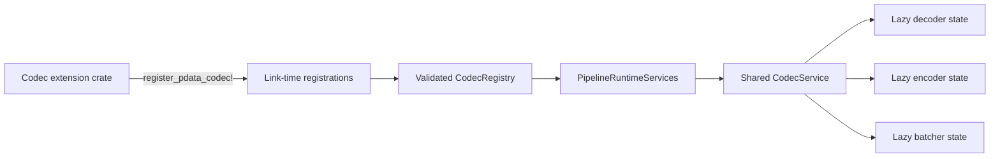
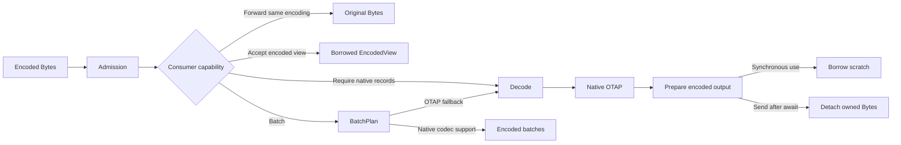
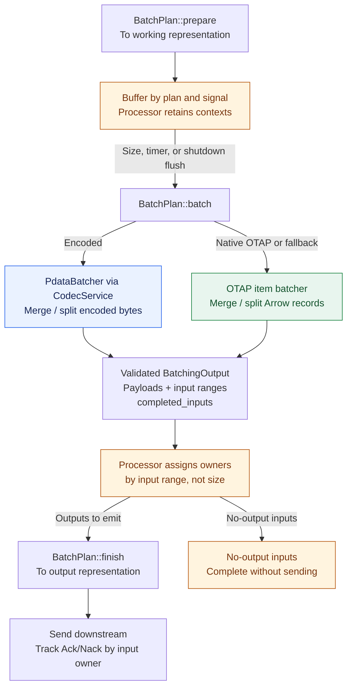
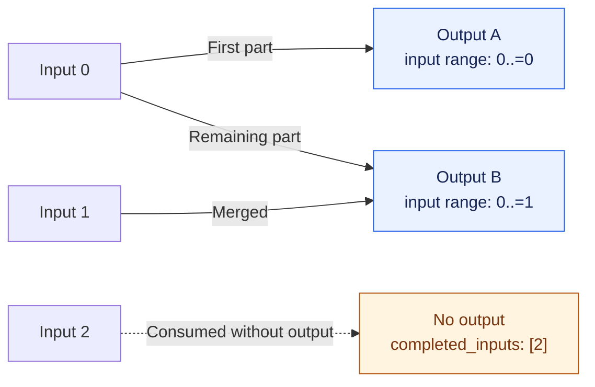

# PData codecs

This crate is currently pre-1.0. Its public API may evolve between minor
releases.

This crate defines the extension boundary between independently decodable byte
formats and native OTAP Arrow records in the OTel Arrow Dataflow Engine.

Codecs describe an encoded representation, register immutable factories at link
time, and keep mutable decoder, encoder, or batcher state inside one pipeline
runtime. A payload carries only its encoding identity, signal, bytes, and cached
metadata; it never owns a codec instance.

## Architecture overview

![PData forwarding, views, conversion, batching, and codec lifecycle][codec-diagram]

[codec-diagram]: assets/pdata-codec-framework.png

The four paths are alternatives selected by the consumer, not sequential
pipeline stages:

- **Unchanged forwarding (blue):** a matching output encoding forwards the
  original shared bytes without decoding, re-encoding, or creating a codec
  instance. This guarantee does not apply to merge/split operations.
- **Read-only view (teal):** `AcceptedEncodings` selects direct byte borrowing.
  Existing OTAP records are borrowed; other encodings decode to temporary OTAP
  records without changing the original payload.
- **On-demand conversion (orange):** decode to native OTAP when processing
  requires records, then encode if the output requires an encoded format.
  Already-native input skips decoding.
- **Codec-aware batching (purple):** `BatchPlan` selects codec-native merge/split
  or native OTAP batching, including item-based fallback. Outputs carry input
  ranges for delivery tracking; the processor retains contexts and owns Ack/Nack.
  Encoded batching can create new buffers and instantiate a reusable batcher
  without materializing OTAP. See [batching flow](#batching-flow) and
  [input-range ownership](#input-ranges-and-delivery-ownership) for details.

The lower band shows codec registrations, registry validation, and the pipeline
service that lazily creates and reuses decoder, encoder, and batcher instances.
Nodes access that service through effect handlers; stateless item counters do
not require an instance.

The syslog encoding is marked as upcoming in PR5, not part of PR3.
Native OTAP is the common processing representation, not a registered byte codec.

## Design model

- `PdataEncoding` is the stable identity used by configuration and diagnostics.
  Put incompatible format versions and intrinsic compression in that identity.
  HTTP and gRPC compression remain transport properties.
- `CodecMetadata` declares the signals supported by an encoding and optional
  descriptive metadata.
- `CodecRegistration` supplies decoder, encoder, item-counter, and native
  batching capabilities. A codec may be decode-only or encode-only. A decoder
  must provide an item counter so requested flow metrics remain available.
  Native item batching also requires a counter, including for encode-only codecs.
- `CodecRegistry` validates the complete link-time registry once. Duplicate or
  invalid identities fail pipeline runtime construction deterministically.
- `CodecService` creates mutable implementations lazily and reuses them within
  one pipeline runtime. Payload admission and matching-format forwarding do not
  instantiate a codec.
- `AcceptedEncodings` identifies the resolved encodings a read-only node can
  inspect directly. Obtaining a `PdataView` borrows these bytes or existing
  native records; other encodings are decoded to native OTAP.
- Native OTAP remains the mutable processing representation and the fallback
  intermediate for conversion between different encodings.

Every encoded payload must be independently decodable. Stream-relative state,
such as a dictionary shared across batches, is not a pdata encoding unless each
payload contains everything needed to reconstruct that state.



Receivers, processors, and exporters in one pipeline receive clones of the same
runtime-services handle. The registry is immutable after validation, while the
service creates only the mutable codec state that the pipeline actually uses.

### Direct borrowing and accepted encodings

`PdataPayload::encoded_view()` borrows the existing encoding identity, signal,
and bytes together, or returns `None` for native OTAP. It performs no registry
lookup, codec creation, validation, decoding, buffer cloning, or allocation.
The consumer must check the encoding and signal before interpreting the bytes.
An `EncodedView` guarantees that bytes are available, not that their content is
valid or that the consumer accepts them.

Use `AcceptedEncodings` when a consumer supports selected encodings directly
but also needs native fallback. It selects encodings for direct access, not an
input whitelist: encodings absent from the set are decoded to owned native OTAP,
rather than rejected. Already-native records are always borrowed. An empty set
requires native OTAP access for every input. Borrowed encoded views do not
validate their content.

Resolve and reuse the set through the effect handler:

```rust,ignore
let accepted_encodings =
    effect_handler.resolve_accepted_encodings(&[PdataEncoding::OTLP])?;
let view = effect_handler.view(payload, &accepted_encodings).await?;
```

### Owned native access and delivery ownership

Nodes use `PdataEffectHandlerExtension` from the OTAP crate to obtain owned
native records through pipeline-managed codecs. Choose the operation according
to who owns delivery context and whether processing needs original-input recovery:

| Operation | Use when | Successful result |
| --- | --- | --- |
| `materialize_otap(pdata)` | Context and records should remain together | `OtapArrowPdata` |
| `materialize_otap_payload(payload)` | The caller already manages context separately | `OtapArrowRecords` |
| `prepare_otap_work(pdata)` | Working records and delivery ownership must be independent | `(PdataDelivery, OtapArrowRecords)` |
| `update_otap(pdata, update)` | A synchronous, fallible update needs recovery bookkeeping | `(OtapArrowPdata, R)` |

Materialization consumes its input and decodes only when necessary. Already-native
records move directly without creating a codec. Decode failures return the exact
original input for the caller to Nack or retry. Successful ordinary
materialization retains no original snapshot for subsequent processing failures.

`prepare_otap_work` retains a shallow snapshot before conversion only when
`RETURN_DATA` requires recovery after processing. `update_otap` uses that same
retention policy around its synchronous callback. Async algorithms instead keep
the delivery owner from `prepare_otap_work` across their awaits; no codec borrow
survives into the algorithm.

`PdataDelivery` is an inline, non-`Clone`, `#[must_use]` owner of delivery context
and conditionally retained input. `with_payload` attaches an output to the
context; `into_pdata` constructs a message for Ack/Nack with retained input, or
an empty payload of the original signal when none was retained. Neither method
sends anything, and dropping the owner does not acknowledge automatically.

`OtapPdata::into_work()` separates delivery ownership from a working payload
without materializing it. `OtapPdata::into_delivery()` transfers an already-used
input into delivery ownership without cloning, retaining or discarding its
payload according to `RETURN_DATA`.

## Implement a codec

Implement `PdataDecoder` to convert complete encoded batches to native OTAP.
Implement `PdataEncoder` when exporters may produce the format. Stateful
implementations can retain bounded scratch memory because factories create one
instance lazily per pipeline runtime.

Decoder implementations must:

- Treat the input as untrusted and return `CodecError` instead of panicking.
- Preserve the signal supplied by the caller.
- Recover after an error so the same instance can decode a later valid batch.
- Avoid retaining the input `Bytes`; the engine preserves it for Nack or retry.

Encoder implementations must produce complete, independently decodable output.
The basic `encode` method returns owned `Bytes`. An encoder with reusable scratch
storage can override `prepare_encode`. A synchronous consumer can borrow the
prepared bytes, while an asynchronous sender calls `EncodeOutput::into_bytes`
before `.await` to detach ownership from codec state.

## Execution and asynchronous ownership

Codec decoder, encoder, and batcher methods currently execute synchronously
while the pipeline-local codec service has exclusive access to the selected
instance. Prepared output may borrow an encoder's scratch buffer only during a
synchronous callback. `EncodeOutput::into_bytes` detaches the output before an
asynchronous transport send; it does not offload or make the encoder itself
asynchronous.

The node-facing `PdataEffectHandlerExtension` operations are asynchronous so a
future execution layer can offload work without changing every node API. Their
current implementations perform the synchronous codec call before the future
completes. The async signature is therefore an extension seam, not a guarantee
that codec work runs outside the pipeline runtime.

A slow codec would therefore block the calling pipeline runtime today. The
engine service boundary is the intended integration point for a future bounded
executor: fast codecs can remain inline, while codecs explicitly classified as
blocking can receive owned inputs and return owned outputs through offloaded
work. That execution policy is not part of the current codec contract.



## Register a codec

Declare static metadata and build a registration with only the capabilities the
format supports:

```rust,ignore
use otel_arrow_dfe_config::SignalType;
use otel_arrow_dfe_pdata_codec::{
    CodecMetadata, CodecRegistration, PdataEncoding, register_pdata_codec,
};

const EXAMPLE_ENCODING: PdataEncoding = PdataEncoding::new("example-v1");

static EXAMPLE_METADATA: CodecMetadata = CodecMetadata::new(
    EXAMPLE_ENCODING,
    &[SignalType::Logs],
)
.with_format_version("1");

register_pdata_codec!(
    EXAMPLE_CODEC,
    CodecRegistration::new(&EXAMPLE_METADATA)
        .with_decoder(|policy| match policy.validation() {
            DecodeValidation::BestEffort => Box::new(ExampleDecoder::best_effort()),
            DecodeValidation::Strict => Box::new(ExampleDecoder::strict()),
        })
        .with_item_counter(count_items),
);
```

Decoder factories receive the pipeline decode policy once, when the lazy
pipeline-local instance is created. `BestEffort` permits a faster parser that
may not discover malformed fields it does not visit. `Strict` must reject
malformed content anywhere in the encoded batch. A codec without a useful
relaxed implementation can return the same strict decoder for both policies.

The built-in OTLP codec uses allocation-free borrowed protobuf views in
best-effort mode. Those views validate outer framing, but their nested
iterators currently cannot distinguish malformed content from normal
exhaustion. Strict OTLP decoding therefore uses Prost to validate the complete
nested message before Arrow conversion. Encoded pass-through performs no
decoding or validation under either policy.

The function-style macro is intentionally thin. It hides the link-time inventory
and required unsafe-lint exemption, so an extension crate does not need a direct
`linkme` dependency. The typed const builder remains the source of registration
options and compiler diagnostics instead of being duplicated in a custom macro
syntax. A procedural attribute macro would require another crate and generated
code without improving this contract.

Registration and duplicate-name policy belong to the registry, not the macro.
Registration order is not a precedence mechanism, and the default registry
rejects duplicate identities independently of link order.

A stateless item counter is required for every registration with a decoder or
native item batching. Return `None` when malformed bytes cannot be counted; zero
means the payload was inspected and contains no primary-signal items. Payloads
cache successful counts, keeping an unavailable count distinct from zero. Count
caches are codec-owned; receivers and processors cannot inject arbitrary counts.

## Add native batching

Implement `PdataBatcher` only when encoded batches can be merged or split
without first materializing OTAP records. Register it with
`CodecBatcherRegistration::new` and `CodecRegistration::with_batcher`. Its
`BatchingSupport` declares the supported sizing units and default `BatchSettings`
(sizing unit, thresholds, and split budgets). Declaring `BatchSizer::Items`
requires an item counter to measure both
inputs and outputs, even without a decoder or when the default unit is bytes.
Registry validation rejects missing counters before pipeline startup;
encode-only codecs with byte-only batching do not require one.

### Batching flow

`BatchPlan` selects a working representation and an output representation before
buffering starts. In preserve mode, codecs without matching native batching use
OTAP fallback with item sizing and emit OTAP. An explicit output codec instead
requires an encoder; an encode-only codec can therefore be an output target.
`prepare` converts its mutable payload argument to the working representation
in place; `finish` converts it to the output representation. Matching formats
are untouched, and failed conversions preserve the original payload for recovery.
`PdataPayload` can hold bytes or native records; `OtapPayload` is its transitional
alias, not a guarantee of Arrow storage.

The diagram shows the successful buffered path. Blue is encoded batching without
OTAP materialization; green is native OTAP batching, including conversion fallback.
The processor owns scheduling and delivery; batchers receive payloads, not
contexts.



Already in-range inputs skip buffering and merge/split, but still pass through
`finish` before forwarding with their original delivery context. A small final
output can stay buffered in the working format only when it belongs solely to
the last buffered input. A remainder spanning several inputs is sent immediately,
avoiding ambiguous ownership if later split again.

This is local capability validation, not graph-wide representation negotiation
or a node-signature system. OTLP is a built-in encoded codec. Its dedicated
`OtlpBytes` storage is temporary and is removed by PR4; native OTAP alone is the
special mutable processing representation.

### Input ranges and delivery ownership

A native batcher must preserve item order within a call and produce independently
decodable outputs. This does not promise global processor ordering: an in-range
input can bypass previously buffered input. A batcher must understand its format's
boundaries; arbitrary byte concatenation or splitting is not generally valid.

Each output reports an inclusive range of indices into that batching call's
input vector. Capture these ranges while planning or executing the batch, before
integrity repair or encoding can change counts and sizes. Outputs are ordered;
only a shared boundary input may occur in consecutive ranges when it is split.
List inputs consumed successfully without any output in `completed_inputs`.
Ranges and completed indices must account for every input without overlap
between those two categories. A failed call must return an error instead.

This example splits input 0 across two outputs and merges its remainder with
input 1. Input 2 is consumed successfully without output, for example when
integrity repair removes all of its records. Arrows show contribution, not
size conservation.



| Original input | Successful completion requires | Failure routing |
| --- | --- | --- |
| 0 | Ack from both A and B | A Nack from either output fails input 0 |
| 1 | Ack from B | A Nack from B fails input 1; A has no effect |
| 2 | No downstream Ack; the batching call consumed it without output | A failed batching call must return an error instead |

The plan validates ranges before the processor uses them. The processor installs
all output references before releasing pending input references, preventing early
completion when one input contributes to multiple outputs. A tracked input
completes once: after all of its outputs succeed, or on the first failure.

Measurements control flush thresholds and splitting, not delivery ownership.
Byte sizing includes encoding wrappers and intrinsic compression but excludes
transport framing and compression. Split targets are best effort for indivisible
entries or exhausted amplification budgets. Size estimation is a separate future
optimization; this API currently uses exact measurements.

Implementation entry points: [batching plans and codec contracts](src/batching.rs),
[shared input-range result](../pdata/src/batching.rs), and
[processor scheduling and completion](../core-nodes/src/processors/batch_processor/mod.rs).

## Test a codec

Enable the `testing` feature and run `assert_decode_conformance` with valid and
malformed samples for every supported signal. Use a codec service configured
with `DecodeValidation::Strict` when supplying malformed input. The shared
harness verifies signal and item-count preservation, repeated failure behavior,
recovery, and state reuse.

Add codec-specific tests for:

- Format boundary cases and strict malformed-input handling.
- Conversion fidelity and representation-specific limits.
- Independent decoding of every encoded output.
- Bounded scratch, allocation, and decompression behavior.
- Encoder recovery after limits or other failures.
- Native batching ranges, no-output completion, split limits, and output decoding.

From `rust/otap-dataflow`, validate changes with:

```console
cargo test -p otel-arrow-dfe-pdata-codec
cargo clippy -p otel-arrow-dfe-pdata-codec --all-targets -- -D warnings
```

Run `cargo xtask check` before submitting a pull request.

The built-in OTLP codec is the reference implementation for a codec supporting
decoding, encoding, borrowed views, stateless item counting, reusable buffers,
native batching, and all three telemetry signals.
