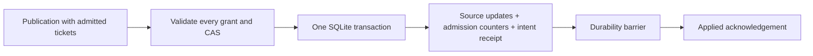

# Durable WorkCoordinator state

Linux-local storage for assignment grants and opaque source progress in one
transaction boundary. The engine owns the asynchronous writer and assignment
protocol; this leaf crate owns blocking storage, fencing, and conditional writes.

The backend uses bundled SQLite with rollback journaling and `synchronous=EXTRA`.
The crate's default `sqlite` feature enables it; engine consumers opt in through
the engine's `durable-authority` feature. With SQLite disabled, or on other
platforms, protocol types remain available and opening storage is rejected.
It requires a private, provisioned state root on a local filesystem with working
locking and durability barriers. It does not establish source identity, authorize
Ack/Nack progress, or qualify forced takeover or an advanced Filelog receiver.

## Ownership and format

`Store::open(root, namespace, limits)` is blocking. The root must already exist,
be owned by the effective UID, and have access bits 0700. The provisioner protects
its ancestors. Namespace directories use 0700 and regular files use 0600, one
hard link, and the same owner. Symlinks and unexpected artifacts are rejected.
Do not rename or modify the root or its artifacts while a writer is open.

The namespace directory is `work-coordinator-v1-<sha256(namespace)>`. It contains:

| Artifact | Purpose |
| --- | --- |
| `ownership.lock` | Nonblocking, exclusive `flock`, retained until SQLite closes |
| `state.sqlite` | Authoritative database: application ID `0x57435331`, schema version 1 |
| `state.sqlite-journal` | SQLite's rollback journal, including interrupted transactions |
| `initialized` | `DFEWC001` followed by the database's 16-byte random identity |

The initialization marker is published and synchronized before the first handle
is returned. A missing database with an existing marker fails closed. An
interrupted empty initialization can finish; committed state is never replaced
by an empty database. Unknown versions, identity mismatches, corruption, or
inconsistent admission counters require operator intervention.

The database contains four tables:

| Table | Stored state |
| --- | --- |
| `meta` | Namespace identity, current epoch, receipt sequence high-water mark, and transactional admission counters |
| `grants` | Assignment ID, last term, exact opaque token, and active/retired state |
| `progress` | Stable source ID, its assignment binding, CAS revision, and opaque bytes |
| `receipts` | Epoch/sequence, intent digest, and the definite transaction outcome |

Each exclusive open atomically increments the epoch, clears prior grants, and
retains source progress. Epochs and operation sequences cannot wrap. A grant
from a previous epoch cannot mutate current state, even if its term or participant
identity is reused. The immediately preceding epoch's bounded receipts remain
queryable; historical success does not grant current ownership.

There is no import or migration of the Filelog checkpoint journal. Source-format
upgrades, namespace migration, source reassignment, and progress garbage
collection need a source-qualified protocol. Changing storage settings requires
stopping the owning logical pipeline first.

## Transaction boundary

Activation requires no conflicting active grant and a term newer than the last
retired term. Retirement compares the complete current grant. Source commits
compare the current grant and expected source revision for every contributing
record before applying any update. Revision zero registers a new source and binds
it to that assignment; subsequent commits cannot silently change that binding.

One publication can cover several sources and assignments in the same namespace:



SQLite uses rollback journaling, a bounded page cache, and `synchronous=EXTRA`.
The durability contract assumes a local filesystem and storage stack that honor
SQLite's locking and synchronization requirements. See SQLite's
[atomic commit model](https://www.sqlite.org/atomiccommit.html) and
[synchronization settings](https://www.sqlite.org/pragma.html#pragma_synchronous).
Network filesystems, broken flush guarantees, and external modification of an
open database are outside this qualification.

Per-publication work touches contributing records and transactional counters;
it does not scan or clone all source state. Startup verifies database integrity,
stored counters, and requested bounds before exposing a new epoch.

## Unknown outcomes and bounds

Within an epoch, identical replay of a retained operation returns its original
outcome without applying it again. Reusing the ID for different intent is rejected.
A command below the current receipt window stays `Unknown` and cannot run again
under that ID. Bounded out-of-order submission inside the window is supported.
After reopen, use `resolve` for historical receipts; replay cannot revive an old
grant.

An I/O failure poisons the store. It cannot certify a receipt or accept another
mutation; retrying only a synchronization barrier is not recovery. The engine
invalidates the authority domain and joins the writer. Remediate storage before
reopening, then inspect recovered progress and receipts. Never infer that an
unknown command failed or advance a source frontier from a missing receipt.

`Limits` bounds assignments, source records, aggregate/per-source progress bytes,
publication items/bytes, receipt retention, and database pages. Current and
preceding epochs retain at most two receipt windows. Logical quota rejection is
atomic; physical database exhaustion follows the I/O-failure path. Provision
space for the database plus its rollback journal (bounded here to twice the
database limit), indexes, and metadata.

Retired assignment terms remain as tombstones until an exclusive epoch restart;
quota pressure never evicts them. Use stable assignment IDs, such as fixed
virtual partitions, and budget assignment history. Source records also remain
until a qualified source policy can retire them. Reaching a quota stops admission
rather than discarding progress.

## Qualification tests

From `rust/otap-dataflow`:

```sh
cargo test -p otel-arrow-dfe-work-coordinator-state --features test-utils
```

The `test-utils` feature provides explicit interruption callbacks. The engine's
dev dependency enables them for workspace tests; production builds do not enable
this feature. Crash cases run in a separate test binary to isolate process
spawning from concurrent lock-owning tests. They exit without unwinding storage
during activation, retirement, and multi-source writes, including after commit
but before acknowledgement. Large progress records force real rollback-journal
writes before the mid-transaction interruption.

These tests cover process interruption and recovery on the actual filesystem.
They do not simulate power loss or qualify a receiver's source/publication path.
