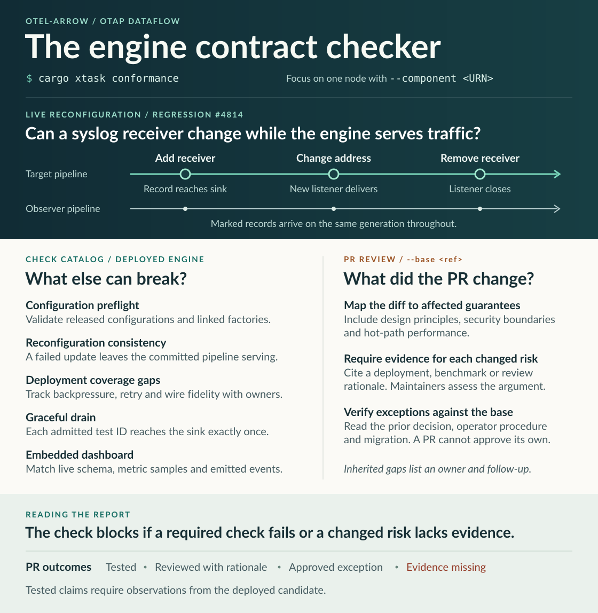

# Engine conformance checks

Read the [AI-assisted review guide][review] and [design principles][design]
before assessing the full diff and its callers. The configuration model and
observable component behavior are user contracts. APIs can evolve through
the ordinary project review process. The [change rules][rules] find likely
areas of impact. Reviewers can add an area that automation missed.

## Reading the local report

The command deploys the candidate and observes live reconfiguration, graceful
drain and the embedded dashboard. Released configs and linked factory
validators have a separate preflight result.
An absent, skipped, failed or flaky observation cannot pass
as evidence. The summary groups areas outside the diff rules on one line.
The [live operation table][live] identifies which components have direct
evidence. The terminal and HTML reports list registered pipeline components
with **No live reconfiguration fixture**. The JSON report (`--metrics PATH`)
lists their URNs in `coverage.components_without_live_fixture`, including
components available only on other platforms. A catalog fixture that failed
or could not run has its own result.

For a review against a base revision, save the affected paths and your evidence
in a local YAML assessment file, such as `target/assessment.yaml`. Link durable
decisions and operator procedures in the repository.

```yaml
evidence:
  - area: behavior
    paths:
      - rust/otap-dataflow/crates/core-nodes/src/processors/batch_processor/mod.rs
    status: tested
    source: finite-id-drain
    reason: The deployed batch pipeline delivers each admitted ID once during graceful shutdown.
```

Run `cargo xtask conformance --base origin/main --assessment target/assessment.yaml`.
With `--base` alone, the report identifies the evidence still needed.

- **Tested** records cite a passing run from this candidate. Built-in names
  include `live-rollout`, `extension-rollout`, `rejected-update`,
  `reconfiguration-consistency`, `embedded-ui` and `finite-id-drain`.
  Cite one passing operation as `rollout:URN/OPERATION`.
  Existing unit tests can support the review rationale.
- **Reviewed with rationale** records give a concrete argument and a source
  (repository path, optionally with a fragment, or an HTTPS evidence link).
  For example, identify which runtime owns a buffer, what bounds it, and what
  happens when it fills. The contributor supplies evidence. The native
  code-owner review decides whether that reasoning is sufficient.
- **Approved exception** records cite a decision already present on the base
  branch in `exceptions/`. Include the exact area as a bullet under
  `Scope`, plus `Justification`, `Operator procedure`, `Migration and release`,
  `Verification`, and `Decision` sections. For component exceptions also list
  the exact URN and operation on one bullet. Link the maintainer decision and
  the tested migration. An exception proposed by the same change is pending.
- **Evidence missing** blocks for a new or changed risk. Document an inherited
  gap with an owner and follow-up and supply evidence for the behavior the
  change actually touches. When a compatibility break is necessary, identify
  affected users, the replacement, timing and migration in the operator docs
  and existing breaking-change changelog. Changes to protected expectations, exceptions
  and fixtures go through maintainer review.

## How the checker works

The [check catalog](checks.yaml) describes deployed scenarios, preflight checks
and inherited gaps.
Use `--component <URN>` to check one factory, its [release inputs][release-inputs],
its [live fixture][fixtures] and its applicable behavior checks. The full suite
also supports PR review.

The [conformance binary][driver] owns the deployment scenarios and fixtures.
To follow a component from its catalog entry to a finding, read these in order.

1. The [execution plan][plan] selects checks and fixtures using the full URN,
   linked factories and available prerequisites. A full run schedules the same
   fixture that a component author gets with `--component`.
2. The [fixture lifecycle][lifecycle] runs add, change and remove in order.
   In `step`, `candidate_pipeline` builds the requested graph, the
   [fixture session][fixture-session] rolls it out while probing the observer,
   and `observe` checks the data-plane effect. The session uses the validation
   library's [engine session][session] for process lifetime and the admin API.
3. The driver writes [lifecycle outcomes][outcomes]. A failed operation carries
   its diagnostic. Later operations stay unexercised. At the [xtask entry
   point][xtask], the command runs the driver or reads saved observations.
   The [evidence checks][evidence-code] validate each build before merging its
   observations. [Coverage][coverage-code] compares the observations against
   registered components, [PR review][review-code] evaluates changed risks,
   and the [report][report-code] presents the result.

For dashboard changes, start with the [signal catalog][ui-signals] and
[dashboard deployment][dashboard-code]. The [reconfiguration scenarios][reconfiguration-code]
exercise rejection and rollback. The [drain scenario][drain-code] accounts for
records admitted before shutdown. Each has its own entry in the execution plan.

[driver]: ../../crates/conformance/README.md
[plan]: ../../crates/conformance/src/plan.rs
[lifecycle]: ../../crates/conformance/src/live.rs
[fixture-session]: ../../crates/conformance/src/fixture_session.rs
[session]: ../../crates/validation/src/deployment/mod.rs
[outcomes]: ../../crates/conformance/model/src/rollout.rs
[xtask]: ../../xtask/src/conformance/mod.rs
[evidence-code]: ../../xtask/src/conformance/evidence.rs
[coverage-code]: ../../xtask/src/conformance/coverage.rs
[review-code]: ../../xtask/src/conformance/review.rs
[report-code]: ../../xtask/src/conformance/report.rs
[dashboard-code]: ../../crates/conformance/src/dashboard.rs
[reconfiguration-code]: ../../crates/conformance/src/reconfiguration.rs
[drain-code]: ../../crates/conformance/src/drain.rs



The terminal, JSON and HTML report the same findings. Missing, skipped, failed
or retried tests cannot support a passing claim. The full report lists
inherited coverage gaps with an owner and follow-up. A new component or a
previously covered operation that loses coverage requires evidence. Maintainers
decide whether the rationale supports merging the change.

For example, `--component urn:otel:processor:fanout` runs the YAML fixture to
add the processor, change its output and remove it. Its independent
backpressure guarantee is listed as **not yet validated in deployment**.

### Add a deployment conformance check

Use a typed scenario in the conformance crate to start the candidate, drive
the operation and observe the result at the sink or admin API. Add the
operator promise, method, source and applicable URNs to the catalog.
While a scenario is outstanding, use `gap.owner` and `gap.follow_up`.
The full and focused reports surface that gap to reviewers.

## From guidance to evidence

| Review guide section | What to inspect | Existing evidence or reviewer responsibility |
| --- | --- | --- |
| Agent Reviewer Quick Checklist and Agent Reviewer Instructions | Full diff, callers, test changes and remaining risk | Report specific findings, affected scenarios, evidence and residual risks. Run the async blocking script on runtime changes. |
| Review Posture | Ownership boundaries, complexity, new mechanisms | Explain the trade-off, reuse opportunities and a concrete alternative for material concerns. |
| Core Architectural Invariants | Thread-per-core locality, bounded work, backpressure and external library assumptions | Look for blocking or shared runtime paths. Link actual capacity, cancellation and admission evidence. |
| Runtime and Performance | Ingest, encode, dispatch, storage and dependency changes | Use Criterion or a base/candidate workload. Explain differences in CPU, throughput, memory or latency. |
| Design and Serviceability | Config, live topology, no-op/rejection, drain, continuity, APIs and diagnostics | Validate released inputs and effective settings. Run an operator scenario and verify actual delivery. |
| Metric Instrumentation | Units, instrument kind, aggregation, dimensions and secrets | Apply the existing metric and item attribute guides and linked semconv checks. |
| Correctness, Security, and Portability | Input fidelity, refusal, unsafe code, trust boundaries, crypto features, platform behavior and test reliability | Inspect negative tests, inventory drift, dependency and platform jobs. Record the threat, mitigation and remaining risk for new boundaries. |

Follow the design guide for predictability, easy defaults, scalability,
allocation, synchronization, context switches, extensibility, programmability,
observability, interoperability, reliability, security and privacy. Explain
specific departures with a maintainer-reviewed decision. Automated triggers
help locate evidence and the full-diff review covers interactions across paths.

## Operator scenarios and performance

From the Rust workspace, run the fast checks on the current working tree.
The default uses Cargo, a native engine, temporary files and loopback sockets.
Add a Git base to include the evidence review for committed, staged, unstaged
and untracked changes. Use the immediate parent branch when reviewing a stack.

```sh
cargo xtask conformance
cargo xtask conformance --base origin/main
```

### Exporting the report

Use `--html PATH` to save a self-contained HTML file that opens offline.
Add `--open` to view it in your default browser. On its own, `--open`
writes `target/conformance.html`. Output paths are relative to the directory
where you run the command.

```sh
cargo xtask conformance --open
cargo xtask conformance --base origin/main --html target/pr-review.html
cargo xtask conformance --component urn:otel:processor:transform --html target/transform.html --open
```

The report opens with the verdict and any blocking findings, even when the
command exits unsuccessfully. Failed dashboard observations show the consumer,
signal and diagnostic together. Expand the run details for passing observations,
platform exclusions, component results and inherited coverage gaps.

Expand a conformance check to read its contract, the steps that exercise it and
the names and source of its tests. These explanations also appear on focused
component checks. When adding a check, describe it in the
[check catalog](checks.yaml),
including its deployment entry points or the owner and follow-up for the gap.

Full reports group component operations by their registered
URN namespace. The OpenTelemetry section (`urn:otel:`) comes first, followed
by one section per company namespace, such as `urn:microsoft:`. An OTel
component targeting a vendor service still appears under OpenTelemetry.
Coverage gaps are listed separately.
With `--base`, they include review outcomes and evidence links. A component
report shows the factory result, lifecycle operations and applicable behavior
checks. Repository links refer to the local checkout. You can also pass
`--metrics PATH` to write the JSON report to a separate file.

### Reusing saved observations

On a clean checkout, `--observations FILE` reads the conformance driver's raw
observations from the same revision. For example, from the Rust workspace:

```sh
cargo build --locked -p otel-arrow-dfe -p otel-arrow-dfe-conformance \
  --features otel-arrow-dfe/offline-fixtures,otel-arrow-dfe-conformance/offline-fixtures
target/debug/conformance --binary target/debug/df_engine target/observations.json "$(git rev-parse HEAD)"
cargo xtask conformance --observations target/observations.json --html target/conformance.html
```

If you set `CARGO_TARGET_DIR`, use the binaries from that target directory.
The checker validates the revision and fixture coverage before using these
observations. `--metrics` writes the final report for readers.

### Checking one component

Use the full registered URN to check its factory's rejection of invalid
configuration and its add, change, and remove fixture. The observer pipeline
and delivery checks run at each stage. Focused JSON reports include
`behavior_checks` and `deployment_gaps` with an owner and follow-up.

```sh
cargo xtask conformance --component urn:otel:processor:transform
cargo xtask conformance --component urn:otel:exporter:otlp_http --metrics target/otlp-http.json
```

A controller extension receives startup configuration validation. For a
pipeline component, a missing fixture, missing prerequisite or unlinked
factory makes the focused check exit unsuccessfully and explains the gap.
Unknown URNs are rejected against the source inventory. Use the full suite
to review a change against a base revision.

### Backpressure, wire fidelity, reconfiguration and drain

| Check | Evidence and component selection |
| --- | --- |
| Backpressure, retry, wire fidelity, controller planning and Kafka in-place topic selection | Inherited deployment gaps. Each keeps its contract ID and proposed experiment in the catalog. |
| `reconfiguration-consistency` | The admin scenario reapplies the committed pipeline, then submits a valid replacement whose listener cannot bind. It checks the failed rollout, the previous generation and delivery through both pipelines. Runs in the full suite. |
| `finite-id-drain` | Batch and durable buffer select a real pipeline with both processors. Seven individually admitted log IDs remain in a partial batch until graceful shutdown. The capture must then contain each ID exactly once. |

Each catalog fixture also reapplies the changed configuration with the subject
installed. The admin operation must complete as a no-op, retain the committed
generation and pass the normal delivery probe. A focused report records
`reconfiguration-noop` when the fixture reaches this step. A failed add leaves
the no-op in `unexercised_checks` and later operations unexercised.
Independent behavior checks still run.

```sh
cargo xtask conformance --component urn:otel:processor:fanout
cargo xtask conformance --component urn:otel:exporter:otap
cargo xtask conformance --component urn:otel:processor:durable_buffer
```

### Embedded dashboard

Run the dashboard deployment alone, or omit `--check embedded-ui` to run the
full suite. Both paths use the same Rust probe and [YAML signal catalog][ui-signals].

```sh
cargo xtask conformance --check embedded-ui --html target/dashboard.html
```

The probe loads the dashboard at `/` and `/dashboard`, follows its local
asset references and module imports, and checks their content types. It compares
the API paths referenced by those modules with the endpoints it exercises.

The fixture needs two available engine cores. A marked syslog record crosses a
topic and reaches the file exporter. The probe checks the following observations.

| Dashboard surface | Evidence from the running engine |
| --- | --- |
| Channel charts and DAG | Both metrics routes expose scoped senders and receivers for data and control channels. Each pair joins on a channel ID. Sent and received counts increase during the workload. Idle gauges and error counters can be zero. |
| Charts and tooltips | Each applicable instrument has the expected unit, instrument kind and temporality, and a nonempty brief in the live schema and both metrics responses. The catalog identifies platform-specific instruments. |
| All-core selector | Two reader instances supply distinct core IDs. Removing the core, thread and NUMA dimensions leaves one series. Worker counts sum to two and the mean of the two 32-slot channel capacities is 32. |
| Status overlay | During creation, a pipeline with no observed runtime reports 0/0 cores and both conditions are unknown. A held receiver port then produces a runtime error, 0/1 running cores and a failed ready quorum. The healthy and shutdown event checks run on separate pipelines. |
| Live logs | A slow WebSocket subscriber falls behind while the fixture generates local audit events. The error supplies the last delivered sequence in `lag_before_seq`. The probe backfills from it, verifies contiguous pages against the retained HTTP logs and recovers the missed events. |

The topic topology uses an empty string when a process ID is absent, matching
the UI's single-process behavior. The log viewer renders arbitrary event names.
The probe checks the fields on real entries and observes any explicitly named
events in the stream or retained snapshot.

Terminal, HTML and JSON reports list each UI consumer and signal. The
[signal evaluator][evaluator] checks schema declarations, usable samples and
scoped traffic increases. The checker uses the same catalog to reject incomplete
observations from the deployment runner.

When a dashboard change adds, renames, or removes a telemetry dependency,
update `telemetry-signals.yaml` in the same change. Reviewers check that the
list matches what the UI reads. Under `sets`, each metric maps a catalog key
to its wire name and metadata. Use `dimensions` for
scope, `series` for required label values, and `traffic: true` when the marked
workload must increment the series. Use `channel` to identify endpoint roles and
`allCores` for the per-core and aggregate values. Under `events`, list status
kinds, conditions and expected pipeline states, the lag cursor, log fields,
and any explicitly named logs. Give a newly required event a
reproducible trigger in the deployment if the existing workload does not emit it.

### Add a live fixture for a component

Follow the [fixture authoring guide][authoring] to configure a component,
prepare its input files, and choose an observable result for each rollout.
It includes a complete processor fixture and follows the host-metrics receiver
from its checked-in assets to the two running pipelines. The generated
[support table](live-support.md) shows which components have a fixture and
what each remaining gap needs.

The component fixture checks the behavior specified by its probe. Engine-wide
scenarios also check that the committed generation keeps serving after an
invalid graph or an attempt to change startup-owned settings, such as the
observability pipeline. Controller extensions receive startup checks.

For a provisioned environment, pass one `--with NAME` per prerequisite declared
by its fixtures. To combine observations from several environments, pass repeated
`--observations FILE` options on the clean candidate.
A new or changed fixture needs passing evidence from a build that exercises it.

### Released configurations

The candidate engine runs `--validate-and-exit` on the pipelines pinned in
[`crates/conformance/fixtures/releases/`][release-inputs]. Each result names
the release and file. The full report groups them by component URN, including
registered components with **No released configuration checked**. A focused
`--component` run validates the whole pipelines that declare that component.
A failure identifies the pipeline and engine diagnostic. It can come from any
node in that pipeline. A passing file covers only the settings it exercises.

The v0.60.0 YAML files are copies of the tagged syslog and batch examples.
The full run converts the syslog input to JSON once, checks acceptance, then
points an edge at a missing node and checks the rejection diagnostic.
Together the two releases cover the syslog and OTLP receivers, the gRPC and
HTTP OTLP exporters, and both ends of OTAP and Kafka. Processor coverage
includes batch, temporal reaggregation, type router, content router, retry,
attribute, filter and transform.

Seven fixtures are exact copies from the [v0.60.0][release60] and
[v0.66.0][release66] configuration directories and retain their filenames.
Three v0.66.0 fixtures adapt tagged examples for standalone validation:

- `temporal-reaggregation.yaml` wraps the graph from
  `crates/validation/validation_pipelines/temporal-reaggregation-processor.yaml`.
- `kafka.yaml` uses the Kafka receiver and exporter README examples with a
  distinct output topic.
- `content-router-otlp-http.yaml` connects the content router and OTLP HTTP
  exporter Getting Started examples to an OTLP receiver.

Add a tagged input that exercises the documented setting when reviewing a
change to that setting. Preserve earlier fixtures. Use a deployment observation
for a change to a default or behavior that still parses successfully.
To retire an accepted input at the approved release boundary,
add an entry to `release-migrations.json` in this guide's directory. Key it
by the old release-relative filename (for example, `v0.60.0/example.yaml`).
Set `replacement` to an accepted fixture, `diagnostic` to the expected
rejection text, and `decision` to a protected decision already on the base.
Its scope names `configuration` and `configuration v0.60.0/example.yaml`.
The local preflight exercises the old input and the proposed replacement
on the same binary.

The live test sends uniquely identified records to the primary
and observer pipelines and checks the committed configuration after rejection.

For each added URN, include a `benchmarks` entry in the local assessment.
Use its full URN as the key, `measurement` for the evidence link, and
either `workload` for the repository-relative continuous suite path or
`obstacle` for the reason and reproduction steps.

For new components, include a representative pipeline in the existing
[continuous benchmark][continuous] where feasible. Identify the actual
workload invoked by CI and its tracked signals. If an external service or
platform prevents continuous coverage, document that obstacle, the alternative
measurement and how to reproduce it. Use the existing `cargobench` and
`pipelineperf` PR labels for focused runs. Record the same input, batch size,
build features and hardware for a base/candidate comparison.

## Regression history

For a bug fix or near miss, record the broken operator workflow, why coverage
missed it, sibling components at risk and the lasting check. Link an existing
test when it already establishes the property. Start with the [incident
history][history]. The Arrow maintainers own backfill from release bug-fix
entries, reverts, closed issues and recurring review threads. Work backwards
by release and link each entry to a case, a prior equivalent case, or a
reasoned review question.

When evaluating the suite, save reports with `--metrics PATH`. Compare
caught regressions, misses, flaky failures, elapsed time after the build and
the share of component operations with passing observations.

[review]: ../ai/ai-assisted-pr-review.md
[design]: ../design-principles.md
[rules]: review-map.json
[ui-signals]: telemetry-signals.yaml
[authoring]: ../../crates/conformance/fixtures/README.md
[fixtures]: ../../crates/conformance/fixtures/fixtures.yaml
[live]: live-support.md
[history]: history.md
[release-inputs]: ../../crates/conformance/fixtures/releases/
[release60]: https://github.com/open-telemetry/otel-arrow/tree/c9d3a4d507c7a2aced1148eb9a6eca9cf34b5981/rust/otap-dataflow/configs
[release66]: https://github.com/open-telemetry/otel-arrow/tree/c65b8c8195258da5eb0742c939e641b07dc9dccf/rust/otap-dataflow/configs
[continuous]: ../../../../.github/workflows/pipeline-perf-test-continuous.yml

[evaluator]: ../../crates/conformance/model/src/ui.rs
