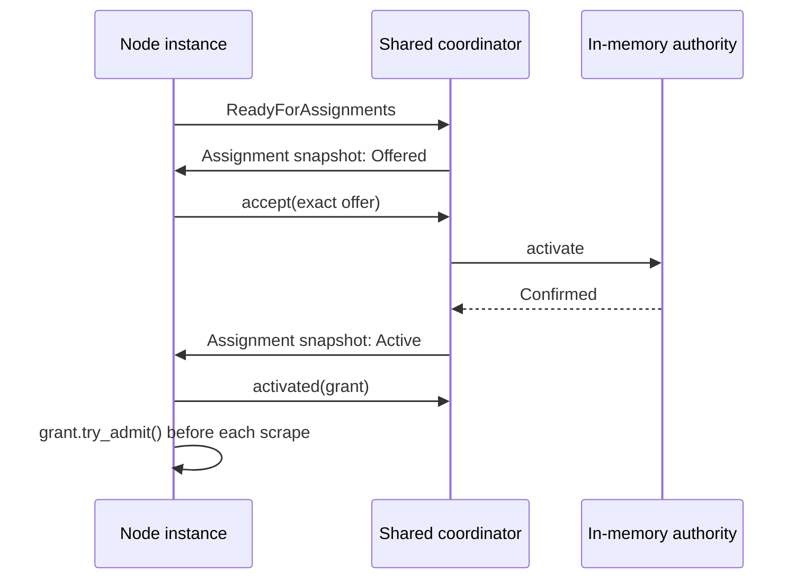

# Using a WorkCoordinator

The API in `otel_arrow_dfe_engine::work_coordinator` lets a node share discovery
and distribute work across pipeline instances, without a YAML extension or
checkpoint store. Receivers, processors, and exporters use the same declaration
and binding API.

The [RFC](../rfcs/0000-work-coordinator.md) describes the complete direction.
Both implemented profiles support initial Prometheus integration:

| Profile | Supported lifecycle |
| --- | --- |
| Basic (default) | Fixed fleet, catalog updates, no-op reconciliation, shutdown |
| Cooperative (opt-in) | Basic operations plus live resize, compatible replacement, rollback, qualified per-core recovery |

Durable ownership, source progress adapters, and the Fenced profile remain future
work. An initial Filelog integration can use this API for discovery and
cooperative distribution, but cannot claim checkpoint ownership or durable
delivery guarantees from it.

## Declare and bind

Implement `WorkProtocol` with immutable work metadata, `ParticipantRequest`, and
`CoordinatorNotice` types. Each implements `RetainedBytes`; count allocation
capacities and nested owned allocations. Only metadata crosses threads. The
node's state, provider state, and their futures can remain `!Send`.

A factory's optional `work_coordinators` function receives `NodeUserConfig` and
returns declarations. It validates settings and captures them in a `Send`
factory. Declaration must not discover resources, open files, or start workers.

```rust,ignore
fn declare(config: &NodeUserConfig) -> Result<Vec<CoordinatorDeclaration>, ConfigError> {
    let settings = parse_settings(&config.config)?;
    Ok(vec![CoordinatorDeclaration::new::<PrometheusProtocol, _>(
        "targets",
        move || Box::new(TargetDiscovery::new(settings)),
    )])
}

// ReceiverFactory, ProcessorFactory, or ExporterFactory:
// work_coordinators: Some(declare),

// During node construction, using its node-scoped PipelineContext:
let participant = pipeline_ctx.work_coordinator::<PrometheusProtocol>("targets")?;
```

Identity is `(group_id, pipeline_id, node_id, role)`. Duplicate roles, unsupported
capabilities, wrong protocol types, repeated binding, and obsolete generations
fail explicitly. Unconnected nodes do not start coordinators. Bind once and
retain the participant inside the node; avoid lookups during execution.

## Discover and execute

The controller starts each provider on an independent, unpinned thread with a
current-thread Tokio runtime. The provider implements `WorkCoordinator<P>` and
receives `CoordinatorRuntime<P>`:

1. Initialize discovery and submit its initial catalog with `replace_catalog`.
   An empty catalog is valid. Call `ready` to allow dependent node construction.
2. Publish later catalogs and handle custom requests. Separate watch subscriptions
   expose the participant registry and final shutdown signal.
3. On shutdown, stop and join discovery workers before returning. The host awaits
   provider cleanup. Detached blocking work is outside this contract.

Each node calls `ready_for_assignments` before signaling node readiness. This
does not wait for ownership. Allocation starts after the entire initial fleet is
ready. The default allocator keeps existing owners and places new targets on the
least-loaded participant, using core order to break ties. Cooperative joins
rebalance existing work through the same release/install handshake.



`recv` returns either a complete assignment snapshot or a custom notice. Replace
the local assignment view on each snapshot; delivery can coalesce intermediate
views. Track installed terms so later snapshots do not restart existing workers.
Offers do not authorize execution. A grant permits admission only after
`activated` has acknowledged installation.
Catalog changes can make an offer stale before acceptance; handle `Stale` by
refreshing the complete view with `resynchronize`, without starting that work.

Keep each `AdmissionTicket` alive through its operation and publication/completion
path. For Prometheus this can cover one scrape and its downstream send. When a
source requires downstream Ack before progress, its adapter must retain the
ticket through that completion. A dropped ticket does not mean Ack or prove a
worker stopped. Authority loss invalidates tickets; participants must stop their
workers and publication path when it occurs.
Use `authority_loss` to select that signal alongside long-running I/O.

Catalog removal stops new admissions immediately. A `Revoking` assignment stays
in snapshots until the node settles tickets, joins workers, and calls `released`.
Only then does the authority retire it. Re-adding the same ID uses a fresh term.
Work metadata for an existing ID is immutable within its settings revision until
retirement: encode a discovery change in a new ID, or remove, await release, then
re-add. Different settings revisions can carry different metadata for the same
ID. Catalog receipts acknowledge acceptance; they do not acknowledge worker
cleanup.

## Opt into live reconciliation

The node implementer supplies immutable discovery settings and a side-effect-free
compatibility predicate:

```rust,ignore
CoordinatorDeclaration::new::<PrometheusProtocol, _>("targets", move || {
    Box::new(TargetDiscovery::new(initial_settings))
})
.with_reconciliation(settings_json, |old, next| {
    old["authority"] == next["authority"]
})
```

The controller preserves the host when `(group_id, pipeline_id, node_id, role)`,
node provider, protocol, profile, and resource limits remain compatible. The
predicate approves discovery settings changes; rejected changes require a
restart. Declarations run during planning and must remain free of side effects.

Use an equality predicate (`|old, next| old == next`) to support resize and
downstream changes first. Equal settings reuse the committed revision and send
no provider lifecycle events. Supporting changed discovery settings also requires
handling the dedicated `runtime.lifecycle_events()` stream:

| Event | Provider responsibility before acknowledging its `ProviderReceipt` |
| --- | --- |
| `Prepare` | Start candidate discovery and publish its initial catalog with `replace_catalog_for(revision, works)`; preserve committed discovery |
| `Commit` | Stop and join discovery workers for obsolete settings |
| `Abort` | Stop and join candidate discovery workers; preserve committed discovery |

The controller runs this protocol outside pipeline runtimes:

```mermaid
sequenceDiagram
    participant C as Controller
    participant H as Coordinator host
    participant O as Old instance
    participant N as Candidate instance
    C->>H: Prepare compatible settings
    H-->>C: Prepared(revision)
    C->>N: Construct exact session for revision
    N->>H: ReadyForAssignments (no ownership)
    C->>H: Activate candidate
    H->>O: Revoke: stop admission
    O->>H: Released after completion and worker join
    H->>N: Offer / Active grant
    N->>H: Activated after installation
    H-->>C: Activated receipt
    C->>O: Drain pipeline
    C->>C: Commit deployment (irreversible)
    C->>H: Commit; join obsolete discovery
    H-->>C: Committed receipt
```

Preparation can be preempted by abort. Treat a stale catalog write or
acknowledgement as obsolete work and continue servicing lifecycle cleanup;
do not turn it into a provider failure. An explicit failed preparation receipt
promises that its candidate workers have already been joined. Losing that
receipt instead requires a subsequent `Abort` acknowledgement.

Old and candidate catalogs coexist under separate, monotonic settings revisions.
Publish every discovery update with `replace_catalog_for` for its revision;
`replace_catalog` is shorthand for revision zero. Old participants continue to
see their old metadata during preparation. Registration uses an exact core,
runtime generation, and fresh session nonce. Runtime generations and settings
revisions are independent; a recovered instance retains the committed settings
revision.

Before the deployment commits, failure aborts candidate authority and restores
the prior deployment with fresh grants. Abort cancels any unfinished handoff
before candidate drain or old-instance relaunch; its final receipt waits for
release and restoration. Rollback may relaunch old instances;
prior grant terms never become valid again. After commit, failure or delay of
provider cleanup cannot trigger rollback. Obsolete catalog writes are rejected.

Controller operations return a `ReconciliationReceipt` with an operation ID.
`wait()` is asynchronous; `wait_until()` is only for blocking controller workers.
Cancellation or `Timeout` leaves the outcome unknown: query `resolve()` or await
the same receipt again. Neither authorizes overlapping ownership. Final receipts
are retained for replay. Unconfirmed provider cleanup blocks further updates;
shutdown remains available. No controller state mutex is held while waiting.

## Bounds and failure behavior

`CoordinatorLimits` bounds retained work and metadata, participants, custom queue
slots, and queued custom bytes. Pending catalogs have one separate bounded slot.
Catalog capacity includes both live settings revisions and work waiting for
release; pressure never evicts an active grant. Custom sends return `Capacity`
for the caller to backpressure or
retry. Lifecycle acknowledgements have their own bounded queue; assignment and
authority-loss watches cannot be blocked by custom notices.

The controller caps hosts at 32 per logical pipeline and 128 per engine. Provider
startup has a 30-second fleet deadline. Final host shutdown shares one 30-second
deadline across the engine. At most one cleanup worker per reserved host performs
the native join, including runtime and thread-local destruction. Controller state
locks are released before waiting. Settings are bounded to 8 MiB per revision,
with at most two retained revisions. Registration allows at most two bounded
fleets during replacement; abort reclaims candidates that never bound a node.
`CoordinatorBinding::status` exposes
bounded counts and queue bytes without source identifiers. It is an API
diagnostic; admin/metric presentation can be added with receiver integration.

Provider failure and participant exit with unreleased ownership invalidate the
whole authority domain and use the controller's fatal-error shutdown path. Basic
fails closed on every unexpected participant exit. Cooperative per-core recovery
requires physical runtime exit and explicit release of all owned work; a dropped
ticket alone is insufficient. Recovery registers a fresh session, installs its
grants, and then promotes the replacement. Neither profile silently restarts a
coordinator. Normal drain stops admission first, keeps admitted completion paths
alive, and joins hosts
after pipeline shutdown. Providers must cooperate with shutdown; the framework
cannot terminate a blocked OS worker safely.

Timed-out or abandoned startup cleanup keeps the coordinator identity, binding,
and host permit reserved. Reusing that identity is rejected until the native join
finishes. Failure remains observable on repeated shutdown calls. Deployment Drop
signals shutdown without waiting; the engine supervisor and cleanup worker retain
unfinished ownership. If cleanup never finishes, or OS resource exhaustion
prevents creating a cleanup worker, process restart may be required.

Basic live resize and configuration replacement are rejected during planning;
stop/delete and create to change its footprint or settings. Cooperative changes
must preserve declared identities and pass compatibility validation. Fenced and
all source progress requirements beyond `None` still fail admission.

## Executable references

- [Standalone example](../crates/engine/examples/work_coordinator.rs): four
  independently identifiable targets on two instance threads and one host.
- [Controller conformance node](../crates/controller/src/work_coordinator_tests.rs):
  real pipeline construction, shared discovery, execution on two instances,
  normal shutdown, no-op reuse, and rejection before rollout mutation. Its
  [Cooperative fixtures](../crates/controller/src/work_coordinator_tests/cooperative.rs)
  exercise resize, replacement, rollback, and recovery on real runtime threads.
- Engine tests in `work_coordinator/tests.rs` cover stale terms, completion-gated
  release, queue saturation, atomic catalog rejection, failure, and idle readiness.
- [Reconciliation tests](../crates/engine/src/work_coordinator/tests/reconciliation.rs)
  control provider acknowledgements and admitted work to check handoff barriers,
  settings isolation, fresh rollback terms, and irreversible commit decisions.

Run the example from `rust/otap-dataflow`:

```sh
cargo run -p otel-arrow-dfe-engine --example work_coordinator
```
