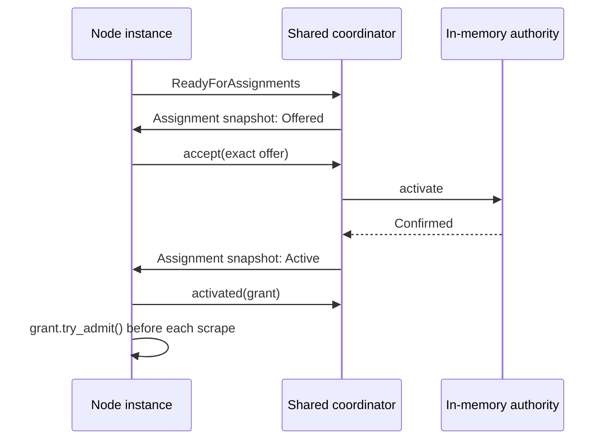

# Using a WorkCoordinator

The Basic API is available in `otel_arrow_dfe_engine::work_coordinator`. It lets
a node share discovery and distribute work across a fixed fleet, without a YAML
extension or checkpoint store. Receivers, processors, and exporters use the same
declaration and binding API.

The [RFC](../rfcs/0000-work-coordinator.md) describes the complete direction.
This implementation enables initial Prometheus integration. Cooperative live
handoff and source progress adapters remain subsequent work.

## Declare and bind

Implement `WorkProtocol` with immutable work metadata, `ParticipantRequest`, and
`CoordinatorNotice` types. Each implements `RetainedBytes`; count allocation
capacities and nested owned allocations. Only metadata crosses threads. The
node's state, provider state, and their futures can remain `!Send`.

A factory's optional `work_coordinators` function receives `NodeUserConfig` and
returns declarations. It validates settings and captures them in a `Send`
factory. Declaration must not discover resources, open files, or start workers.

```rust,ignore
fn declare(config: &NodeUserConfig) -> Result<Vec<CoordinatorDeclaration>, ConfigError> {
    let settings = parse_settings(&config.config)?;
    Ok(vec![CoordinatorDeclaration::new::<PrometheusProtocol, _>(
        "targets",
        move || Box::new(TargetDiscovery::new(settings)),
    )])
}

// ReceiverFactory, ProcessorFactory, or ExporterFactory:
// work_coordinators: Some(declare),

// During node construction, using its node-scoped PipelineContext:
let participant = pipeline_ctx.work_coordinator::<PrometheusProtocol>("targets")?;
```

Identity is `(group_id, pipeline_id, node_id, role)`. Duplicate roles, unsupported
capabilities, wrong protocol types, repeated binding, and obsolete generations
fail explicitly. Unconnected nodes do not start coordinators. Bind once and
retain the participant inside the node; avoid lookups during execution.

## Discover and execute

The controller starts each provider on an independent, unpinned thread with a
current-thread Tokio runtime. The provider implements `WorkCoordinator<P>` and
receives `CoordinatorRuntime<P>`:

1. Initialize discovery and submit its initial catalog with `replace_catalog`.
   An empty catalog is valid. Call `ready` to allow dependent node construction.
2. Publish later catalogs and handle custom requests. Separate watch subscriptions
   expose the participant registry and final shutdown signal.
3. On shutdown, stop and join discovery workers before returning. The host awaits
   provider cleanup. Detached blocking work is outside this contract.

Each node calls `ready_for_assignments` before signaling node readiness. This
does not wait for ownership. Allocation starts after the entire initial fleet is
ready. The default allocator keeps existing owners and places new targets on the
least-loaded participant, using core order to break ties.



`recv` returns either a complete assignment snapshot or a custom notice. Replace
the local assignment view on each snapshot; delivery can coalesce intermediate
views. Track installed terms so later snapshots do not restart existing workers.
Offers do not authorize execution. A grant permits admission only after
`activated` has acknowledged installation.
Catalog changes can make an offer stale before acceptance; handle `Stale` by
refreshing the complete view with `resynchronize`, without starting that work.

Keep each `AdmissionTicket` alive through its operation and publication/completion
path. For Prometheus this can cover one scrape and its downstream send. When a
source requires downstream Ack before progress, its adapter must retain the
ticket through that completion. A dropped ticket does not mean Ack or prove a
worker stopped. Authority loss invalidates tickets; participants must stop their
workers and publication path when it occurs.
Use `authority_loss` to select that signal alongside long-running I/O.

Catalog removal stops new admissions immediately. A `Revoking` assignment stays
in snapshots until the node settles tickets, joins workers, and calls `released`.
Only then does the authority retire it. Re-adding the same ID uses a fresh term.
Work metadata for an existing ID is immutable until retirement: encode changed
target metadata in a new ID, or remove, await release, then re-add. Catalog
receipts acknowledge acceptance; they do not acknowledge worker cleanup.

## Bounds and failure behavior

`CoordinatorLimits` bounds retained work and metadata, participants, custom queue
slots, and queued custom bytes. Pending catalogs have one separate bounded slot.
Catalog capacity includes work waiting for release; pressure never evicts an
active grant. Custom sends return `Capacity` for the caller to backpressure or
retry. Lifecycle acknowledgements have their own bounded queue; assignment and
authority-loss watches cannot be blocked by custom notices.

The controller caps hosts at 32 per logical pipeline and 128 per engine. Provider
startup has a 30-second fleet deadline. Final host shutdown shares one 30-second
deadline across the engine. At most one cleanup worker per reserved host performs
the native join, including runtime and thread-local destruction. Controller state
locks are released before waiting. `CoordinatorBinding::status` exposes
bounded counts and queue bytes without source identifiers. It is an API
diagnostic; admin/metric presentation can be added with receiver integration.

Unexpected participant exit or provider failure invalidates the whole authority
domain and uses the controller's fatal-error shutdown path. Basic never performs
automatic per-core recovery or silently restarts a coordinator. Normal drain
stops admission first, keeps admitted completion paths alive, and joins hosts
after pipeline shutdown. Providers must cooperate with shutdown; the framework
cannot terminate a blocked OS worker safely.

Timed-out or abandoned startup cleanup keeps the coordinator identity, binding,
and host permit reserved. Reusing that identity is rejected until the native join
finishes. Failure remains observable on repeated shutdown calls. Deployment Drop
signals shutdown without waiting; the engine supervisor and cleanup worker retain
unfinished ownership. If cleanup never finishes, or OS resource exhaustion
prevents creating a cleanup worker, process restart may be required.

Initial creation, unchanged no-op reconciliation, catalog updates, shutdown, and
deletion are supported. Live resize and configuration replacement involving a
coordinator are rejected during planning. Stop/delete and create the logical
pipeline to change its footprint or settings. Cooperative and fenced profiles,
and all source progress requirements beyond `None`, currently fail admission.
Filelog checkpoint ownership is therefore not enabled by this layer yet.

## Executable references

- [Standalone example](../crates/engine/examples/work_coordinator.rs): four
  independently identifiable targets on two instance threads and one host.
- [Controller conformance node](../crates/controller/src/work_coordinator_tests.rs):
  real pipeline construction, shared discovery, execution on two instances,
  normal shutdown, no-op reuse, and rejection before rollout mutation.
- Engine tests in `work_coordinator/tests.rs` cover stale terms, completion-gated
  release, queue saturation, atomic catalog rejection, failure, and idle readiness.

Run the example from `rust/otap-dataflow`:

```sh
cargo run -p otel-arrow-dfe-engine --example work_coordinator
```
