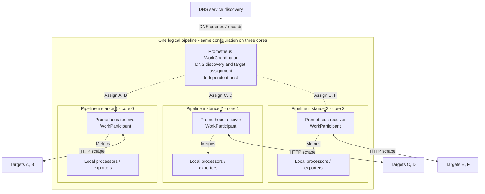
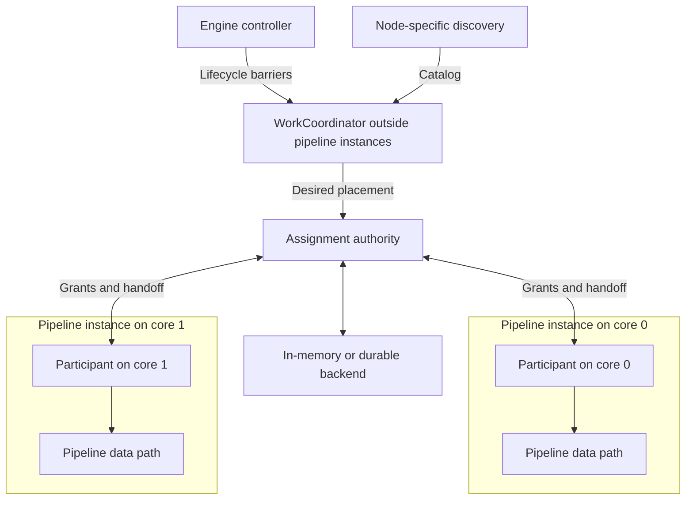
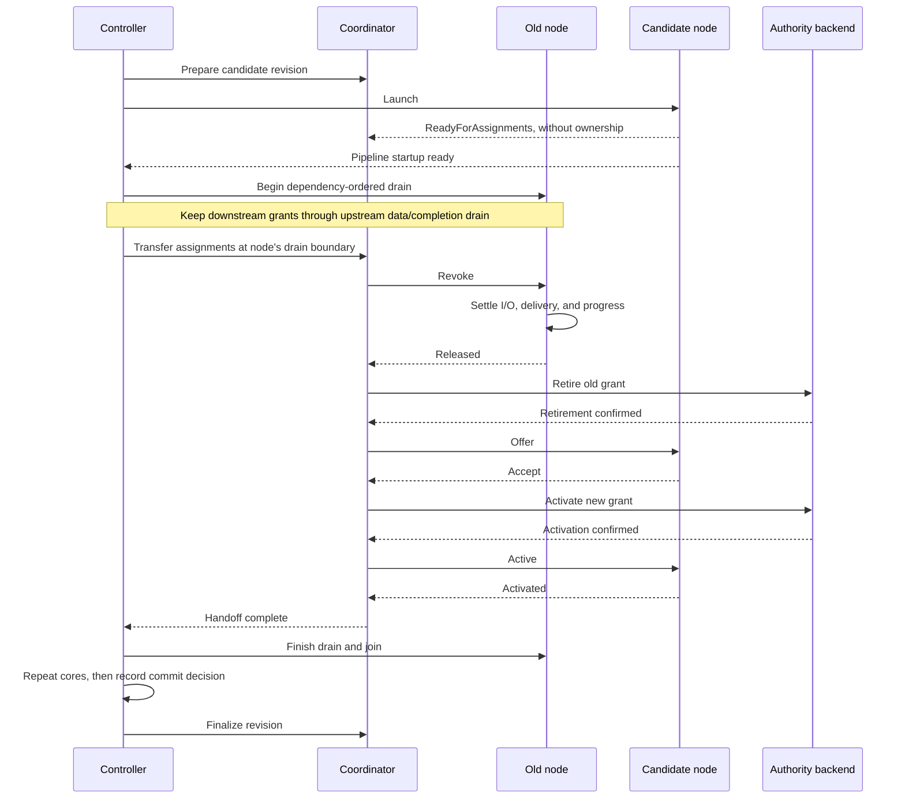

# RFC NNNN: WorkCoordinator

## Summary

Introduce `WorkCoordinator`, a component declared by a node implementation and
hosted outside per-core pipeline runtimes. It discovers or receives work and
coordinates assignments across instances of that node, surviving compatible
pipeline replacements. Typed messages and a common ownership protocol preserve
the engine's local data path. Capability profiles allow adoption from basic
in-memory assignment through durable fencing and checkpointed source recovery.

For example, a Prometheus coordinator discovers targets through DNS and assigns
them across three instances of the same configured receiver:



Each target has one assigned receiver. Scraping and metric processing run in
the owning pipeline instance; the coordinator handles discovery and assignment.

## Motivation

Replicating a pull receiver on several cores can duplicate file reads, scrapes,
and checkpoint writers. Coordination needs a lifetime independent of those
instances and explicit participation in live reconciliation.

The engine's [thread-per-core, share-nothing model][runtime-model] keeps node
state and PData local to each core. Shared discovery and ownership must preserve
that locality while coordinating work across instances.

## Guide-level explanation

The node implementer declares the coordinator dependency; pipeline authors
configure the node without separately wiring coordination infrastructure.
Receivers, processors, and exporters share the contract. Discovery, execution,
and source progress remain node-specific.

### Responsibilities

The controller owns pipeline lifecycle. The node's coordinator supplies a work
catalog and desired placement; a common assignment authority enforces ownership
through an in-memory or durable backend. Each `WorkParticipant` executes assigned
work in its node instance. Work may be a long-lived responsibility, such as a
scrape target or file partition, rather than a Tokio task.



The controller owns lifecycle; each coordinator has an independent thread and
current-thread runtime for discovery and assignment. Progress commits use the
same authority through a separate writer. Per-publication Ack/Nack bypasses both
controller and coordinator loops; controller work is per lifecycle transition.

### Capability profiles

The node declares its required profile and capabilities. The engine rejects
unsupported combinations before startup or live mutation, without silent
downgrade. These are conformance contracts, not a new YAML section.

| Profile | Contract | First uses |
| --- | --- | --- |
| Basic | Fixed-fleet assignment, bounded communication, cooperative catalog changes, and orderly shutdown. No rolling replacement, resize, forced takeover, or automatic per-core recovery. | Multicore Prometheus on a fixed footprint; Filelog discovery with one reader/checkpoint owner per namespace. |
| Cooperative | Adds acknowledged resize, compatible replacement, rollback, and recovery after proven cleanup. Checkpointed multicore execution requires serialized local progress writes. | Prometheus live reconciliation; conservative Filelog handoff and qualified multicore reading. |
| Fenced progress | Adds durable grants, stale-writer rejection, bounded atomic progress transactions, and validated downstream completion. Fenced takeover requires additional source qualification. | Advanced Filelog and other checkpointed sources. |

Basic and Cooperative are independently usable. Early Filelog retains namespace
exclusion and Ack-gated checkpoints; it does not promise transparent failover,
lossless handoff, or record-identical crash replay. Its one-core restriction can
remain until a multicore adapter satisfies the selected profile. A weaker
profile never permits unfenced concurrent writers or checkpointing before Ack.

Cross-process ownership, coordination across logical pipelines, transparent
coordinator restart, and exactly-once delivery are outside this proposal.
Complete receiver implementations are separate work.

## Reference-level explanation

### Identity and lifetime

```text
CoordinatorKey = (group_id, pipeline_id, node_id, coordinator_role)
```

`node_id` is the stable configuration name, not the runtime numeric index. Two
nodes of the same type have separate coordinators. The host lives as long as its
declaration, participating generations, or rollback references require it;
temporarily having no clients does not destroy it.

| Identity | Purpose |
| --- | --- |
| `ParticipantSession` | Core, deployment generation, and a fresh registration nonce within the coordinator. Rejects late messages after recovery or remove/re-add on the same core. |
| `CoordinatorRevision` | Immutable settings revision, independent of deployment generation; committed and candidate revisions may coexist. |
| `WorkId` / `SourceNamespaceId` | Stable work identity and optional checkpoint namespace, independent of placement and coordinator renames. File-centric progress keys remain independent of virtual-partition owners. |
| `AssignmentGrant` | Exact authority epoch/incarnation, work, session, settings revision, and non-reused term. Identifies permission to execute and, where supported, commit progress. |
| `OperationId` | Correlates idempotent lifecycle/backend commands and their receipts. |

Backend terms never become valid again after cancellation, catalog removal, or
restart; overflow fails closed. Durable backends establish the effective epoch
before activating new grants. Namespace exclusion remains necessary because
distinct coordinator keys do not prevent two pipelines selecting the same source.

### Node-facing API

Receiver, processor, and exporter factories gain
`work_coordinators: Option<CoordinatorDeclarationsFn>`. Declaration is a
side-effect-free preparation step. It supplies a role, provider/protocol type,
validated settings and compatibility rules, required capabilities, resource
limits, and a host factory. Duplicate roles and incompatible bindings fail
preparation. Nodes without declarations retain their current execution model.

The factory crosses threads as `Send`; it constructs the coordinator on its
host, allowing coordinator state and its future to be `!Send`. Cross-thread
messages are `Send`, without adding `Send` requirements to local node state.
Protocols define `ParticipantRequest` messages from participants to the
coordinator and `CoordinatorNotice` messages in the opposite direction.
Nodes obtain a typed, session-bound participant during initialization:

```rust
let participant = pipeline_ctx
    .work_coordinator::<PrometheusProtocol>("target_assignment")?;
```

| Surface | Main operations |
| --- | --- |
| `CoordinatorRuntime<P>` | Signal host readiness; receive lifecycle events, `ParticipantRegistry` updates, and `ParticipantRequest` messages; send a `CoordinatorNotice` to one session; propose assignments. |
| `WorkParticipant<P>` | `ready_for_assignments`, `recv`, `request`, `accept`, `activated`, `released`, `progress_writer`, and resynchronization. Events distinguish offers, active grants, revocation, `CoordinatorNotice` messages, and authority loss. |
| Admission guard | `try_admit(grant)` atomically checks admission and reserves execution/publication. Revocation closes admission; retirement/failure invalidate tickets. Dropping a ticket proves neither Ack nor worker exit. |
| `AssignmentBackend<P>` | `capabilities`, `activate`, `retire`, and `resolve` an operation with an unknown outcome. Only a confirmed activation authorizes execution. |
| `ProgressWriter` | Cloneable `Send + Sync` handle for conditional commits, asynchronous receipts/outcome resolution, and source-state reads. |

Offers, grants, and lifecycle receipts are engine-defined and session/revision
checked. Custom messages cannot manufacture authority. Binding/type erasure is
confined to initialization; there is no hot-path registry lookup or per-record
coordination RPC. Messages carry metadata, not PData or live node/I/O handles.
The default allocator retains eligible owners. During rolling replacement,
retained work moves core-for-core; new work follows the target fleet's planned
shares and waits for unready targets. Released old-revision-only work retires,
with metadata retained for rollback. Allocation policy remains
replaceable; Filelog can retain its fixed virtual partitions.

### Authority and progress

The backend interface is present from the start, with storage optional for basic
users. It separates desired placement from permission to act. An offer reserves
work but does not authorize execution: the participant accepts, the backend
confirms activation, and the participant acknowledges installing the grant.
Catalog removal retires ownership before forgetting its entry.

| Progress requirement | Allowed profiles | Enforcement |
| --- | --- | --- |
| `None` | Basic, Cooperative | No checkpoint dependency, as for ordinary Prometheus target assignment. |
| `ExclusiveWriter` | Basic, Cooperative | Singleton checkpoint API under exclusive namespace ownership; all old workers must stop before another writer starts. |
| `SerializedLocal` | Cooperative | One local authority serializes grant validation, progress application, and ownership retirement. |
| `DurableFenced` | Cooperative, Fenced progress | Effective grants and conditional progress share a crash-consistent transaction boundary; stale writers are rejected. |

All combinations require the corresponding backend and source adapter to be
qualified. `CooperativeOnly` is the default takeover policy for every profile;
`AllowFencedTakeover` requires Fenced progress and the source guarantees below.
Selecting durable storage alone does not change a Basic or Cooperative profile.

Serialized/fenced adapters obtain `participant.progress_writer()` and may clone
it into I/O workers without making local participants or node state `Send`.
One bounded writer serializes activation, retirement, and commits for the same
authority domain. Submission returns `Capacity` rather than waiting for queue
space; receipts are awaited asynchronously. Disk I/O stays on the writer worker,
outside admission/queue locks. Per-publication feedback bypasses the coordinator.

Commits carry the namespace, source key, exact grant, expected revision, and opaque
progress. Fenced commits support bounded all-or-none updates across contributing
files/assignments. Independent ownership checks and checkpoint writes are
insufficient. Placement may be reconstructed; committed source progress must
survive.

Activation, retirement, and commits have operation IDs and definite outcomes.
Timeout or caller cancellation does not prove a write failed. Resolve an ambiguous
outcome before another owner activates or a local progress frontier advances.
Backend waits must leave priority control serviceable. Profile upgrades require
exclusive migration that preserves committed progress; unsupported live upgrades
use stop/migrate/restart.

### Lifecycle and reconciliation

The controller creates and readies coordinators before dependent nodes. Its
`ParticipantRegistry` tracks sessions and their readiness/lifecycle state from
controller transitions, not polling administrative observed state.
Basic supports create, no-op, catalog changes, shutdown, and deletion. It rejects
replacement/resize before mutation and stops the logical pipeline on participant
failure instead of attempting unsupported per-core recovery.

Both live profiles use this handoff at each node's safe drain boundary:



**ReadyForAssignments is distinct from owning work.** Otherwise the candidate
could wait for ownership while the controller waits for readiness before
draining the old owner. Idle participants and empty catalogs must not block
readiness.

Stop ingress first. Processor/exporter grants needed to process upstream PData
and unwind Ack/Nack remain accepting until that input/completion path drains.
Then revoke and settle their own admitted work before release. Transferring all
node grants before beginning pipeline drain is not a valid generic cutover.

Unchanged settings reuse the host/revision. Compatible changes stage candidate
settings alongside committed settings; the first candidate must not globally
overwrite behavior for old participants. Incompatible identity, provider, or
state changes require restart or a reviewed migration. Changes requiring one
atomic settings switch across the fleet are outside this proposal.

| Operation | Rule |
| --- | --- |
| Resize | Ready added sessions without ownership; release departing owners, then rebalance once over the target fleet. Scale-up revokes selected common-core grants; common runtimes stay live. |
| Recovery | Use fresh sessions/terms after proven cleanup or qualified fencing. |
| Rollback | Restore prior configuration/eligibility with fresh grants; never revive a term, rewind progress, or undo external effects. |
| Delete/shutdown | Stop ingress; preserve downstream grants and completion paths during drain. Settle tickets and join workers before release/retirement; retire hosts last. Retain failed cleanup state. |

Added-core startup readiness must not wait for rebalancing before departing cores
can drain. Required activations precede a core's serving cutover. The controller
records its final deployment/revision commit decision before host finalization.
A lost final receipt is retried or queried and never permits rolling back a
committed generation. Full-config reconciliation retains its existing partial
commit behavior. Controller locks are never held while awaiting receipts.

### Failure and source guarantees

Every work unit has at most one current authorized owner. Cooperative `Revoke`
closes new admission while existing tickets may settle and commit progress.
`Retire` or fenced takeover invalidates the affected grant and its tickets;
coordinator failure invalidates the whole domain. Commits serialize with
retirement so late Ack cannot mutate progress after its fence.

Under `CooperativeOnly`, `Released` requires settled tickets and physically
stopped workers; retirement follows release. A dropped client/ticket, runtime
exit, or expired deadline alone does not prove cleanup.

`AllowFencedTakeover` additionally requires a qualified backend and source policy:
retire old authority, reject stale mutations and new publication admissions, then
activate a successor with required source state recoverable. Fencing cannot stop
a kernel read or recreate unavailable bytes. Sources requiring physical reader
exclusion can retain cooperative handoff even with durable progress. Recovery may
replay data; the source policy defines its limits.

Coordinator failure invalidates authority, stops dependent admission, and shuts
down the logical pipeline. No profile silently restarts the coordinator. Failed
worker termination follows existing escalation rules; dropping a join handle
is not cleanup. A process restart acquires namespace exclusion and, for a durable
backend, establishes its new authority epoch before admitting work.

Filelog keeps its [source contract][filelog-design]: Ack-gated contiguous progress,
attempt correlation, bounded pending work, and validated downstream completion.
A normal handoff must resolve old-state deltas before changing interpretation or
ownership. Partial decoder/framer state and unread bytes held only by an unlinked
file's old handle require preservation, completion, or rejection of the move.
Checkpoint replay alone is not a solution. Advanced modes also require qualified
multi-file transactions and checkpoint migration; they do not gate early modes.

### Runtime, integration, and validation

Initially host each coordinator on a bounded, controller-owned, unpinned thread
with a current-thread Tokio runtime. Retain extensions' configuration model and
`PipelineRuntimeServices`' per-instance scope. Contracts/binding belong in `engine`,
lifecycle ownership in `controller`, and source/backend adapters in leaf crates.

Supervise actual host/worker termination with deadlines before native joins.
On timeout, retain unfinished handles, ownership, resource reservations, and
failure state; invalidate admission and escalate. Timeout never proves cleanup.
Adapt existing hosting/readiness machinery: `ThreadLocalTaskHandle`'s unbounded
joins and error-suppressing `Drop` are insufficient for this lifecycle contract.

Bound items and retained bytes for messages, catalogs, snapshots, sessions,
transitions, receipts, and staged settings; also cap host threads. Preserve
priority capacity for revocation, invalidation, and shutdown. A missing delta
requires admission suspension and bounded snapshot resynchronization; coalescing
complete snapshots is safe when the latest view replaces the old one. Keep
synchronization brief and memory-only; blocking work uses managed workers.
Control continues under downstream or storage backpressure. Capacity pressure
cannot evict active grants or required transition state.

Expose bounded health, assignment/transition summaries, queue bytes, and blocked
handoff reasons through existing telemetry/diagnostics. Keep source IDs, paths,
URLs, and operation IDs out of metric labels and redact sensitive settings.

Validate early profiles independently of durability, then changed-catalog rolling
replacement, resize/core swaps, recovery/rollback, stale sessions, ambiguous writes,
saturated control, and hung/failed cleanup. Cover snapshot gaps/resynchronization,
dropped tickets, and competing coordinator keys using one `SourceNamespaceId`.
Include processor/exporter drain with upstream data and late completions. Durable
qualification adds real crash/reopen, atomic multi-file, and migration tests.
Deterministic tests use scoped retained-byte counters; benchmarks measure CPU,
RSS, admission-lock contention, handoff latency, and control responsiveness under
churn/backpressure, following the [async guidance][async-guide] and
[reliable-test guidance][reliable-tests].

## Drawbacks

Each coordinator adds a host thread/runtime, queues, snapshots, and lifecycle
state; durable storage also needs a writer worker. Cross-core admission and
handoff add synchronization and failure states to maintain and qualify.
Thread/memory limits and contention measurements are required even though PData
processing stays local.

## Rationale and alternatives

Separate the ownership contract from its hosting implementation:

| Approach | Tradeoff |
| --- | --- |
| Node-declared WorkCoordinator | Encapsulates discovery, exact ownership, and reconciliation without author wiring; adds a dedicated protocol/lifecycle surface. |
| Higher-scoped extension | Viable hosting alternative if implicit node declarations are added. Broader scope alone still needs participant, grant, and reconciliation semantics. Reuse hosting internals where useful. |
| Per-instance discovery or ad hoc shared service | Either duplicates work or makes each node implement its own ownership, bounds, and live-reconciliation protocol. |

## Prior art

- [Source coordination epic #4001][source-epic] and the
  [Prometheus receiver epic][prometheus-epic].
- [Filelog architecture and normative specifications][filelog-design].
- [Live pipeline reconfiguration][live-config].
- Existing [extension contracts][extension-code], [node factories][factory-code],
  and [controller thread hosting][thread-code].

## Unresolved questions

- Finalize the controller/node barriers that enforce dependency-ordered drain
  before freezing public interfaces.
- Specify acceptable fencing evidence and which Filelog conditions permit forced
  takeover; absence of such evidence leaves the move blocked.
- Choose measured default/hard resource limits and the smallest factory/telemetry
  changes needed for Basic adoption.
- Review durable storage/recovery, completion-validation coverage, and Filelog
  migration/state-transfer details before enabling the advanced profile.

## Future possibilities

A shared host runtime, additional allocation strategies, multi-node sharing, and
broader scopes can follow concrete use cases. Transparent coordinator replacement
needs an authority handover protocol. Cross-process coordination additionally
needs an external grant chain honored by the authoritative progress backend.

[source-epic]: https://github.com/open-telemetry/otel-arrow/issues/4001
[prometheus-epic]: https://github.com/open-telemetry/otel-arrow/issues/3277
[filelog-design]: ../docs/filelog-receiver.md
[live-config]: ../docs/admin/live-reconfiguration.md
[async-guide]: ../docs/async-best-practices.md
[runtime-model]: ../docs/ai/ai-assisted-pr-review.md#core-architectural-invariants
[reliable-tests]: ../CONTRIBUTING.md#reliable-tests
[extension-code]: ../crates/engine/src/shared/extension.rs
[factory-code]: ../crates/engine/src/lib.rs
[thread-code]: ../crates/controller/src/thread_task.rs
