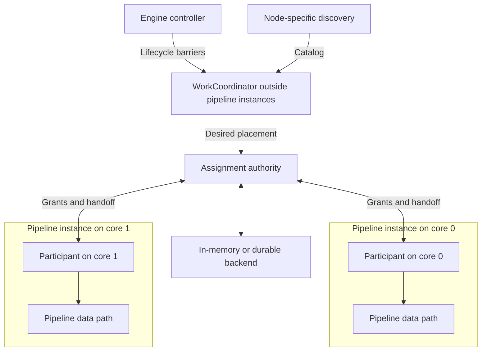
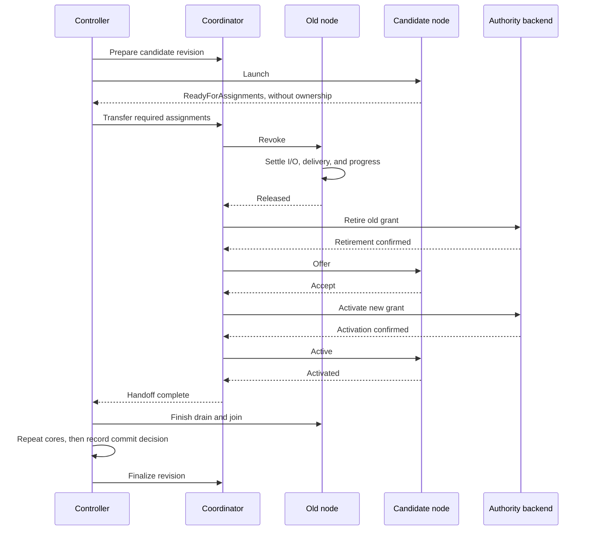

# RFC NNNN: WorkCoordinator

## Summary

Introduce `WorkCoordinator`, a component declared by a node implementation and
hosted outside per-core pipeline runtimes. It discovers or receives work and
coordinates assignments across instances of that node, surviving compatible
pipeline replacements. Typed messages and a common ownership protocol preserve
the engine's local data path. Capability profiles allow adoption from basic
in-memory assignment through durable fencing and checkpointed source recovery.

## Motivation

Replicating a pull receiver on several cores can duplicate file reads, scrapes,
and checkpoint writers. Coordination needs a lifetime independent of those
instances and explicit participation in live reconciliation.

The node implementer declares this dependency. Pipeline authors configure the
receiver's behavior without separately declaring its coordination infrastructure.
The same mechanism can support processors and exporters; source scheduling,
I/O, decoding, and progress representation remain node-specific.

This RFC builds on the source ownership and completion requirements described
in [epic #4001][source-epic]. It introduces node-declared WorkCoordinators and
capability profiles that allow incremental adoption, from basic assignment to
durable fencing and advanced source guarantees.

Cross-process ownership, coordination across logical pipelines, transparent
coordinator restart, and exactly-once delivery are outside this proposal.
Complete receiver implementations are separate work.

## Guide-level explanation

### Responsibilities

The controller owns pipeline lifecycle. The node's coordinator supplies a work
catalog and desired placement; a common assignment authority enforces ownership
through an in-memory or durable backend. Each `WorkParticipant` executes assigned
work in its node instance. Work may be a long-lived responsibility, such as a
scrape target or file partition, rather than a Tokio task.



The authority is a library object on the coordinator runtime. Progress commits
use the same effective authority as assignments, through a separate writer
handle; per-publication Ack/Nack does not pass through the coordinator loop.

### Capability profiles

The node declares its required profile and capabilities. The engine rejects
unsupported combinations before startup or live mutation, without silent
downgrade. These are conformance contracts, not a new YAML section.

| Profile | Contract | First uses |
| --- | --- | --- |
| Basic | In-memory assignment, bounded communication, a fixed participant set, cooperative catalog changes, and orderly shutdown. No rolling replacement, resize, forced takeover, or automatic per-core recovery. | Multicore Prometheus on a fixed footprint; Filelog discovery with one reader/checkpoint owner per namespace. |
| Cooperative | Adds acknowledged resize, compatible replacement, rollback, and recovery after proven cleanup. Checkpointed multicore execution requires serialized local progress writes. | Prometheus live reconciliation; conservative Filelog handoff and qualified multicore reading. |
| Fenced progress | Adds durable grants, stale-writer rejection, bounded atomic progress transactions, and validated downstream completion. Fenced takeover requires additional source qualification. | Advanced Filelog and other checkpointed sources. |

Basic and Cooperative are independently usable. Early Filelog retains namespace
exclusion and Ack-gated checkpoints; it does not promise transparent failover,
lossless handoff, or record-identical crash replay. Its one-core restriction can
remain until a multicore adapter satisfies the selected profile. A weaker
profile never permits unfenced concurrent writers or checkpointing before Ack.

## Reference-level explanation

### Identity and lifetime

```text
CoordinatorKey = (group_id, pipeline_id, node_id, coordinator_role)
```

`node_id` is the stable configuration name, not the runtime numeric index. Two
nodes of the same type have separate coordinators. The host lives as long as its
declaration, participating generations, or rollback references require it;
temporarily having no clients does not destroy it.

| Identity | Purpose |
| --- | --- |
| `ParticipantSession` | Core, deployment generation, and a fresh registration nonce within the coordinator. Rejects late messages after recovery or remove/re-add on the same core. |
| `CoordinatorRevision` | Immutable settings revision, independent of deployment generation; committed and candidate revisions may coexist. |
| `WorkId` / `SourceNamespaceId` | Stable work identity and optional checkpoint namespace, independent of placement and coordinator renames. File-centric progress keys remain independent of virtual-partition owners. |
| `AssignmentGrant` | Exact authority epoch/incarnation, work, session, settings revision, and non-reused term. Identifies permission to execute and, where supported, commit progress. |
| `OperationId` | Correlates idempotent lifecycle/backend commands and their receipts. |

Backend terms never become valid again after cancellation, catalog removal, or
restart; overflow fails closed. Durable backends establish the effective epoch
before activating new grants. Namespace exclusion remains necessary because
distinct coordinator keys do not prevent two pipelines selecting the same source.

### Node-facing API

Receiver, processor, and exporter factories gain
`work_coordinators: Option<CoordinatorDeclarationsFn>`. Declaration is a
side-effect-free preparation step. It supplies a role, provider/protocol type,
validated settings and compatibility rules, required capabilities, resource
limits, and a host factory. Duplicate roles and incompatible bindings fail
preparation. Nodes without declarations retain their current execution model.

The factory crosses threads as `Send`; it constructs the coordinator on its
host, allowing coordinator state and its future to be `!Send`. Cross-thread
messages are `Send`, without adding `Send` requirements to local node state.
Protocols define `ParticipantRequest` messages from participants to the
coordinator and `CoordinatorNotice` messages in the opposite direction.
Nodes obtain a typed, session-bound participant during initialization:

```rust
let participant = pipeline_ctx
    .work_coordinator::<PrometheusProtocol>("target_assignment")?;
```

| Surface | Main operations |
| --- | --- |
| `CoordinatorRuntime<P>` | Signal host readiness; receive lifecycle events, `ParticipantRegistry` updates, and `ParticipantRequest` messages; send a `CoordinatorNotice` to one session; propose assignments. |
| `WorkParticipant<P>` | `ready_for_assignments`, `recv`, `request`, `accept`, `activated`, `released`, and resynchronization. Events distinguish offers, active grants, revocation, `CoordinatorNotice` messages, and authority loss. |
| Admission guard | `try_admit(grant)` locally reserves an operation and its permitted publication/completion. Validation and reservation are atomic relative to invalidation. Dropping a ticket is abandonment, not Ack or proof a worker stopped. |
| `AssignmentBackend<P>` | `capabilities`, `activate`, `retire`, and `resolve` an operation with an unknown outcome. Only a confirmed activation authorizes execution. |

Offers, grants, and lifecycle receipts are engine-defined and session/revision
checked. Custom messages cannot manufacture authority. Binding/type erasure is
confined to initialization; there is no hot-path registry lookup or per-record
coordination RPC. Messages carry metadata, not PData or live node/I/O handles.
Allocation policy is replaceable; the default retains eligible
owners and assigns unowned work. Filelog can retain its fixed virtual partitions.

### Authority and progress

The backend interface is present from the start, with storage optional for basic
users. It separates desired placement from permission to act. An offer reserves
work but does not authorize execution: the participant accepts, the backend
confirms activation, and the participant acknowledges installing the grant.
Catalog removal retires ownership before forgetting its entry.

| Progress requirement | Enforcement |
| --- | --- |
| `None` | No checkpoint dependency, as for ordinary Prometheus target assignment. |
| `ExclusiveWriter` | Existing singleton checkpoint API under exclusive namespace ownership; all old workers must stop before another writer starts. |
| `SerializedLocal` | One local authority serializes grant validation, progress application, and ownership retirement. |
| `DurableFenced` | Effective grants and conditional progress updates share a crash-consistent transaction boundary; stale writers are rejected. |

Serialized/fenced adapters use a `ProgressWriter` for the same authority domain.
Commits carry the namespace, source key, exact grant, expected checkpoint revision,
and opaque source progress. The fenced profile supports bounded all-or-none
updates when a publication spans several files or assignments. Checking ownership
in one place and writing independently elsewhere is insufficient. Persisting the
desired placement plan remains optional; reconstructing placement must preserve
source progress.

Activation, retirement, and commits have operation IDs and definite outcomes.
Timeout or caller cancellation does not prove a write failed. Resolve an ambiguous
outcome before another owner activates or a local progress frontier advances.
Backend waits must leave priority control serviceable. Profile upgrades require
exclusive migration that preserves committed progress; unsupported live upgrades
use stop/migrate/restart.

### Lifecycle and reconciliation

The controller creates and readies coordinators before dependent nodes. Its
`ParticipantRegistry` tracks sessions and their readiness/lifecycle state from
controller transitions, not polling administrative observed state.
Basic supports create, no-op, catalog changes, shutdown, and deletion. It rejects
replacement/resize before mutation and stops the logical pipeline on participant
failure instead of attempting unsupported per-core recovery.

Both live profiles support this cooperative cutover:



**ReadyForAssignments is distinct from owning work.** Otherwise the candidate
could wait for ownership while the controller waits for readiness before
draining the old owner. Idle participants and empty catalogs must not block
readiness.

Unchanged settings reuse the host/revision. Compatible changes stage candidate
settings alongside committed settings; the first candidate must not globally
overwrite behavior for old participants. Incompatible identity, provider, or
state changes require restart or a reviewed migration. Changes requiring one
atomic settings switch across the fleet are outside this proposal.

| Operation | Rule |
| --- | --- |
| Resize | Prepare added sessions; release departing sessions before reassignment. Common-core sessions stay live. |
| Recovery | Use fresh sessions/terms after proven cleanup or qualified fencing. |
| Rollback | Restore prior configuration/eligibility with fresh grants; never revive a term, rewind progress, or undo external effects. |
| Delete/shutdown | Stop admission, preserve completion paths during drain, join node/provider workers, then retire hosts and declarations. Retain failed cleanup state. |

Required activations precede a core's serving cutover. The controller records its
final deployment/revision commit decision before host finalization. A lost final
receipt is retried or queried, not interpreted as permission to roll back a
committed generation. Full-config reconciliation retains its existing partial
commit behavior. Controller locks are never held while awaiting receipts.

### Failure and source guarantees

Every work unit has at most one current authorized owner. Under
`CooperativeOnly`, release means no worker can start, publish, or commit further
work under that grant. Revocation stops new admission while admitted work settles
with its completion path alive. A dropped client, runtime exit, or expired
deadline alone does not establish this; source workers must be accounted for.

`AllowFencedTakeover` additionally requires a qualified backend and source policy:
retire old authority, reject stale mutations and new publication admissions, then
activate a successor with required source state recoverable. Fencing cannot stop
a kernel read or recreate unavailable bytes. Sources requiring physical reader
exclusion can retain cooperative handoff even with durable progress. Recovery may
replay data; the source policy defines its limits.

Coordinator failure invalidates authority, stops dependent admission, and shuts
down the logical pipeline. No profile silently restarts the coordinator. Failed
worker termination follows existing escalation rules; dropping a join handle
is not cleanup. A process restart acquires namespace exclusion and, for a durable
backend, establishes its new authority epoch before admitting work.

Filelog keeps its [source contract][filelog-design]: Ack-gated contiguous progress,
attempt correlation, bounded pending work, and validated downstream completion.
A normal handoff must resolve old-state deltas before changing interpretation or
ownership. Partial decoder/framer state and unread bytes held only by an unlinked
file's old handle require preservation, completion, or rejection of the move.
Checkpoint replay alone is not a solution. Advanced modes also require qualified
multi-file transactions and checkpoint migration; they do not gate early modes.

### Runtime, integration, and validation

Initially host each coordinator on a bounded, controller-owned, unpinned thread
with a current-thread Tokio runtime. Reuse existing hosting/readiness machinery;
retain extensions' configuration model and `PipelineRuntimeServices`' per-instance
scope. Generic contracts and binding belong in `engine`, lifecycle ownership in
`controller`, and source/backend adapters in suitable leaf crates.

Bound items and retained bytes for messages, catalogs, snapshots, sessions,
transitions, receipts, and staged settings; also cap host threads. Preserve
priority capacity for revocation, invalidation, and shutdown. Revision gaps suspend
admission until bounded snapshot resynchronization. Blocking work uses managed
workers; control continues under downstream or storage backpressure. Capacity
pressure cannot evict active grants or required transition state.

Expose bounded health, assignment/transition summaries, queue bytes, and blocked
handoff reasons through existing telemetry/diagnostics. Keep source IDs, paths,
URLs, and operation IDs out of metric labels and redact sensitive settings.

Validation follows the profiles: test early receiver adoption independently of
durability, then overlapping generations, resize/recovery/rollback, stale sessions,
ambiguous backend outcomes, saturated control paths, and failed worker cleanup.
Durable qualification adds real crash/reopen, atomic multi-file, and migration
tests. Include a processor/exporter participant to protect the generic contract.
Measure CPU, retained bytes/RSS, handoff latency, and control responsiveness under
catalog churn and backpressure, following the [async guidance][async-guide].

## Prior art

- [Source coordination epic #4001][source-epic] and the
  [Prometheus receiver epic][prometheus-epic].
- [Filelog architecture and normative specifications][filelog-design].
- [Live pipeline reconfiguration][live-config].
- Existing [extension contracts][extension-code], [node factories][factory-code],
  and [controller thread hosting][thread-code].

## Unresolved questions

- Finalize the participant/admission-guard API and processor/exporter drain
  ordering before freezing public interfaces.
- Specify acceptable fencing evidence and which Filelog conditions permit forced
  takeover; absence of such evidence leaves the move blocked.
- Choose measured default/hard resource limits and the smallest factory/telemetry
  changes needed for Basic adoption.
- Review durable storage/recovery, completion-validation coverage, and Filelog
  migration/state-transfer details before enabling the advanced profile.

## Future possibilities

A shared host runtime, additional allocation strategies, multi-node sharing, and
broader scopes can follow concrete use cases. Transparent coordinator replacement
needs an authority handover protocol. Cross-process coordination additionally
needs an external grant chain honored by the authoritative progress backend.

[source-epic]: https://github.com/open-telemetry/otel-arrow/issues/4001
[prometheus-epic]: https://github.com/open-telemetry/otel-arrow/issues/3277
[filelog-design]: ../docs/filelog-receiver.md
[live-config]: ../docs/admin/live-reconfiguration.md
[async-guide]: ../docs/async-best-practices.md
[extension-code]: ../crates/engine/src/shared/extension.rs
[factory-code]: ../crates/engine/src/lib.rs
[thread-code]: ../crates/controller/src/thread_task.rs
